# Background: macrophage biology

> **Under construction.** This course runs for the first time in spring 2027 and is being built in the open. Interested students are welcome to apply and to give input ([contact](https://zindellab.ch/contact.html), [issues](https://github.com/TizzuLab/blockrophage-course/issues)). **Please do not use these protocols in the lab yet.** Values are unverified until this notice is gone.

This is the background reading for the course. It condenses the Immunology III
lecture on tissue macrophages and the tissue repair lectures to what you need for
the experiments, and it adds the history of the ideas you are going to test. Slide
numbers refer to the Immunology III lecture of 1 December 2025, in the
[slides folder](../slides/README.md) of this repository. Each subsection ends with
questions. We will not collect answers, but we will ask them.

The figures in this chapter are the lecture slides themselves. Figures taken from
the published literature are cited on the slide and remain the property of their
owners; the CC BY licence of this repository covers the lecturer's own material only.

## 5.1 A cell with many names

In 1892 Ilya Mechnikov described cells that eat: small eaters, which we now call
neutrophils, and large eaters, the macrophages. Aschoff grouped them with
endothelial and reticular cells into a reticulo-endothelial system. In the late 1960s
van Furth and colleagues replaced that with the mononuclear phagocyte system, built
on the premise that every tissue macrophage is a blood monocyte that has left the
circulation and settled. In 1973 Steinman added the dendritic cell as a third member
(slide 3).

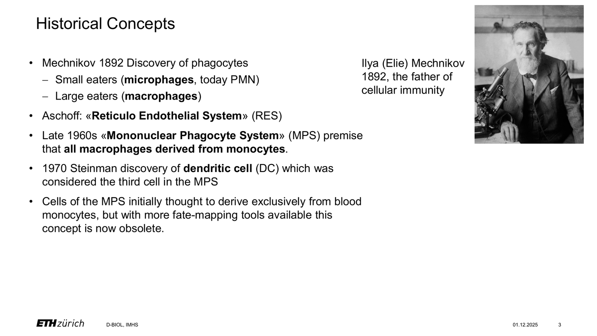

*Figure 1. The historical concepts: Mechnikov's phagocytes, Aschoff's reticulo-endothelial system, van Furth's mononuclear phagocyte system and Steinman's dendritic cell (Immunology III, slide 3.)*

The monocyte premise held for forty years and then fell within three. Fate-mapping
experiments published between 2010 and 2013 showed that most tissue-resident
macrophages are seeded during embryonic development and maintain themselves by
local proliferation, with little or no input from blood monocytes in the steady state
(Schulz et al. 2012; Yona et al. 2013; Hashimoto et al. 2013). This is the first of
several facts in this chapter that were in every textbook and turned out to be wrong.

The consequence is that a macrophage's name has to answer three questions: where it
came from, where it lives, and what it is doing. The lecture introduced a decision
tree for this (slides 5, 11, 15; Guilliams et al. 2014), and the three levels structure
the rest of this chapter.

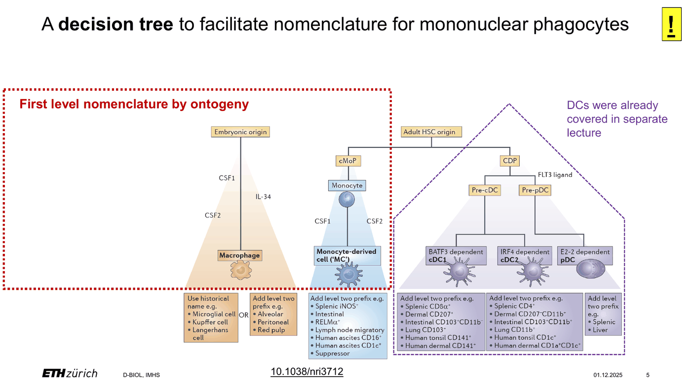

*Figure 2. The nomenclature decision tree for mononuclear phagocytes, adapted from Guilliams et al. 2014: (a) first level by ontogeny, (b) second level by tissue or niche, (c) second level by function or programme. (Immunology III, slides 5, 11 and 15.)*

Questions. Why did it take until 2012 to overturn the monocyte premise, when
macrophages had been studied for a century? What experiment would you design to
show that a tissue macrophage population does not come from monocytes?

## 5.2 Level I: ontogeny

Macrophages arise in waves (slide 9). At embryonic day 8.5 erythro-myeloid
progenitors (EMPs) emerge from the yolk sac in a RUNX1-dependent manner and
colonise the fetal liver. EMP-derived precursor macrophages spread through the
entire embryo during organogenesis, before haematopoietic stem cells (HSCs) exist.
HSCs then emerge from the intra-embryonic endothelium, colonise the bone marrow
before birth, and supply erythroid, lymphoid and myeloid cells, including monocytes
and monocyte-derived macrophages, for the rest of life.

For practical purposes the lecture reduces this to one question (slide 10): is the
cell of embryonic origin under homeostatic conditions? If yes, it is a tissue-resident
macrophage of yolk-sac or fetal-liver origin that self-renews locally. If no, it is
bone-marrow-derived: a monocyte that entered the tissue in a CCR2-dependent manner,
is short-lived, and can expand massively when the tissue is injured or infected. Many
niches are mixed, and the mix shifts with age. The large peritoneal macrophages of
the peritoneal cells extension are an example: embryonic at birth, progressively replaced by
monocyte-derived cells in adult life, faster in males than in females (Bain et al.
2016).

Now place the cells of this course on that tree. RAW 264.7 cells are none of the
above. They were established in 1978 from a tumour induced in a BALB/c mouse by
Abelson murine leukaemia virus (Raschke et al. 1978). They are transformed,
aneuploid, proliferate without CSF1, and have been in culture for almost fifty years.
They respond strongly to LPS and IFNγ, weakly to IL-4, and they lack the inflammasome
adaptor ASC, so they cannot release mature IL-1β (Pelegrin et al. 2008). Bone
marrow-derived macrophages (BMDM) are HSC-derived cells differentiated for seven
days in CSF1; they are the closest in vitro relative of a monocyte-derived
macrophage, and still have never seen a niche. Keep this in mind when you compare
either of them with a cell from a mouse.

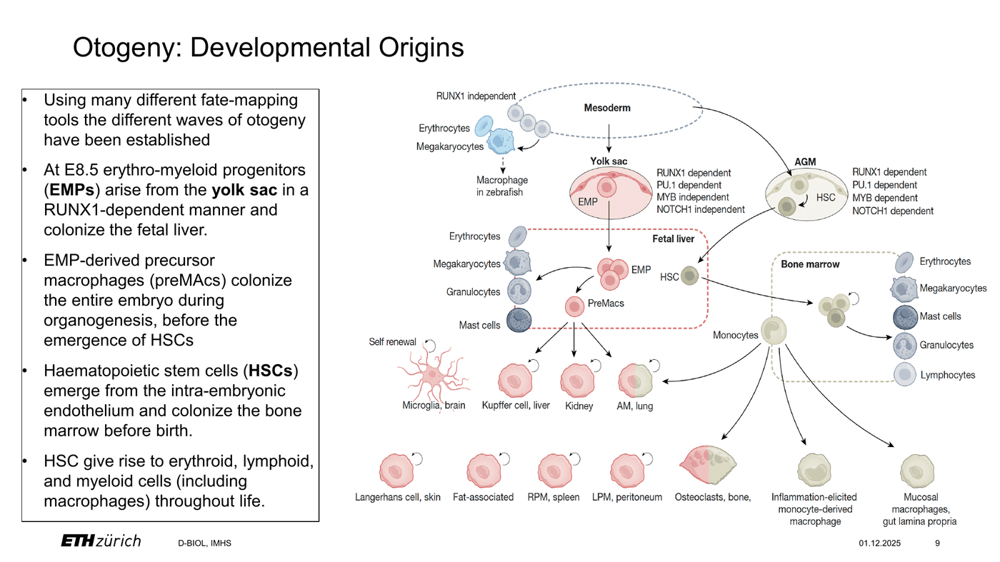

*Figure 3. The waves of macrophage ontogeny: yolk-sac erythro-myeloid progenitors, fetal-liver precursor macrophages and bone-marrow haematopoietic stem cells, and the tissue macrophages each wave supplies (Immunology III, slide 9.)*

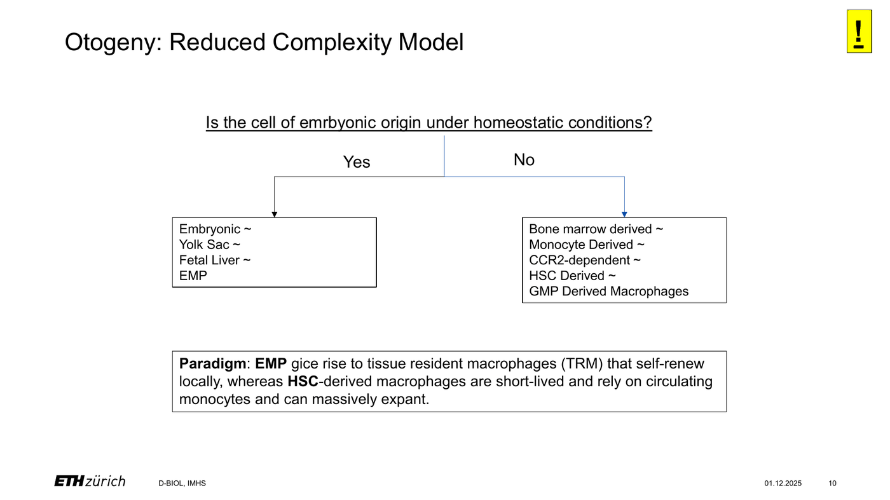

*Figure 4. The reduced-complexity model: one question, is the cell of embryonic origin under homeostatic conditions, separates self-renewing tissue-resident macrophages from short-lived monocyte-derived ones (Immunology III, slide 10.)*

Questions. Which cells in a peritoneal lavage are embryonic in origin, which are
monocyte-derived, and how would you tell them apart on the flow cytometer? What
does "passage number" mean for a cell line, and why does the lab record it?

## 5.3 Level II: niche

Tissue-resident macrophages carry historic names, such as Kupffer cells, Langerhans
cells, microglia and osteoclasts, or a prefix that names the tissue, such as alveolar
or peritoneal macrophages (slide 12). Most organs contain several distinct niches,
sometimes occupied by cells of different origin, which is why a name by niche is
necessary but not sufficient.

The niche model (slide 13; Guilliams et al. 2020) explains how one precursor becomes
many different macrophages. Precursor macrophages share a core transcriptional
programme driven by PU.1, cMAF and IRF8. Each niche then provides three things:
physical space, survival signals, and imprinting signals. The survival signals are
mostly CSF1 receptor ligands, CSF1 and IL-34, and for alveolar macrophages CSF2
(slide 14: CSF1 is M-CSF, CSF2 is GM-CSF, IL-34 is the second CSF1R ligand).
Csf1-deficient mice lack almost all macrophages except Langerhans cells and
microglia, which depend on IL-34; Csf2-deficient mice lack alveolar macrophages, and
humans without a functional CSF2 receptor develop pulmonary alveolar proteinosis
because nobody clears the surfactant. The imprinting signals, such as TGFβ in the
brain, RANKL in bone, retinoic acid in the peritoneum and heme in the spleen, induce
lineage-determining transcription factors on top of the core programme: SALL1 in
microglia, PPARγ in alveolar macrophages, SPI-C in red pulp macrophages, ID3 in
Kupffer cells and GATA6 in large peritoneal macrophages. Whether the niche
instructs the cell or selects among stochastic cell-intrinsic states is still debated.
Either way, the identity of a tissue macrophage is written by the tissue.

The table lists the niches you are most likely to meet in the tissue you are given
for histology. F4/80, the product of the Adgre1 gene, has been the mouse macrophage
marker since 1981 (Austyn & Gordon 1981). It is expressed by almost every tissue
macrophage, but at very different levels, and that is the catch in the immunohistochemistry
extension.

| Niche | Cells | Hallmark markers in mouse | F4/80 |
|---|---|---|---|
| Liver sinusoids | Kupffer cells | CLEC4F, TIM4, VSIG4 | high |
| Lung alveoli | alveolar macrophages | SIGLEC-F, CD11c, PPARγ | low to intermediate |
| Brain parenchyma | microglia | TMEM119, P2RY12, SALL1, CD45 low | positive |
| Spleen red pulp | red pulp macrophages | SPI-C, iron, VCAM1 | high |
| Lymph node sinus | subcapsular and medullary sinus macrophages | CD169, CD209b | low |
| Peritoneal cavity | large peritoneal macrophages | GATA6, TIM4, ICAM2 | high |
| Peritoneal cavity | small peritoneal macrophages | MHCII high, CCR2-derived | low |
| Adipose tissue | lipid-associated macrophages | TREM2, CD9, LPL | positive |
| Bone | osteoclasts | multinucleated, TRAP, RANK | low |
| Skin epidermis | Langerhans cells | CD207 (langerin), IL-34 dependent | positive |
| Intestinal lamina propria | gut macrophages | CX3CR1 high, CD64, monocyte-derived | positive |

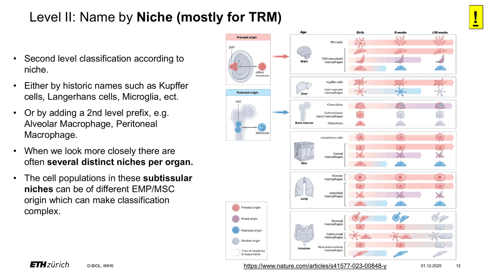

*Figure 5. Naming by niche: historic names or a tissue prefix, and several distinct niches per organ, sometimes of different origin (Immunology III, slide 12.)*

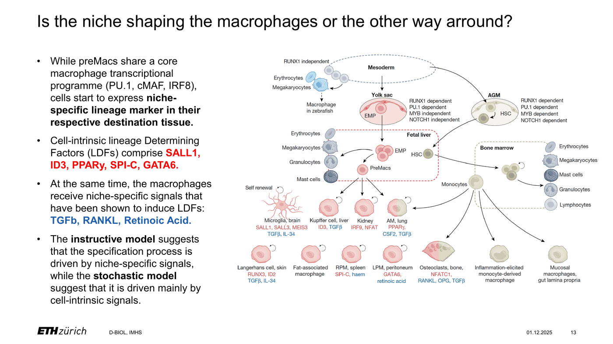

*Figure 6. The niche model: a shared core programme (PU.1, cMAF, IRF8) and niche-specific lineage-determining factors induced by niche signals such as TGFβ, RANKL and retinoic acid (Immunology III, slide 13.)*

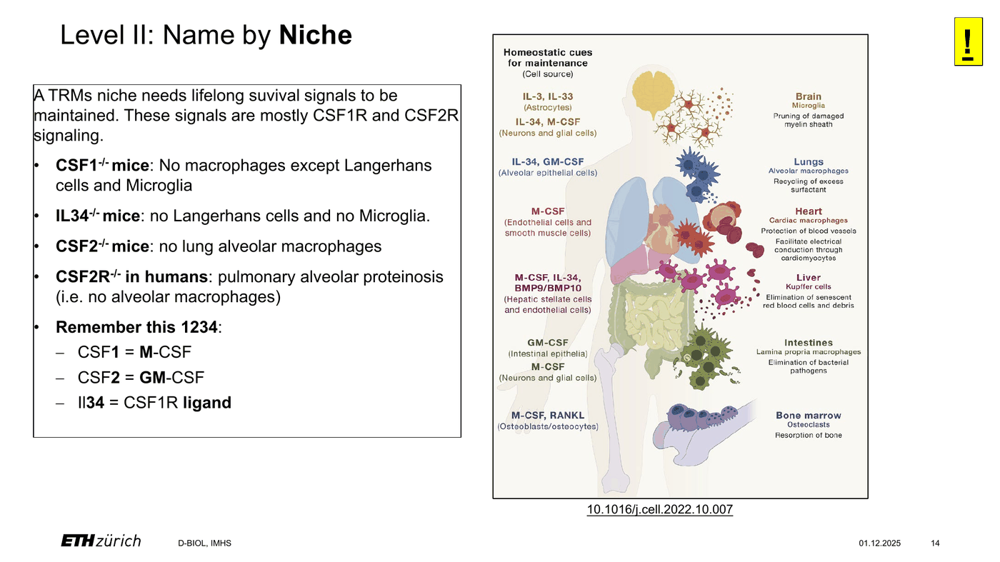

*Figure 7. Survival signals per niche: CSF1 (M-CSF), CSF2 (GM-CSF) and IL-34, the second CSF1R ligand, and the knockout phenotypes behind the rule of 1234 (Immunology III, slide 14.)*

Questions. Pick a tissue. Which niche or niches does it contain, what is the
expected F4/80 level, and what would a negative result of F4/80 staining mean? Which survival factor
would you add to the medium if you wanted to keep macrophages from that tissue alive
in a dish?

## 5.4 Level III: function, and the rise and fall of M1/M2

In the year 2000 Charles Mills noticed that macrophages from mouse strains with a
Th1-biased immune response metabolise arginine through inducible nitric oxide
synthase (Nos2) to nitric oxide, whereas macrophages from Th2-biased strains
metabolise it through arginase 1 (Arg1) to ornithine and polyamines. He named the two
programmes M1 and M2 in analogy to Th1 and Th2 (Mills et al. 2000). Siamon Gordon
had already described the "alternative activation" of macrophages by IL-4, with the
mannose receptor CD206 as its marker (Stein et al. 1992; Gordon 2003). The two ideas
merged into the textbook scheme: M1, classically activated by IFNγ and LPS, kills
microbes and tumour cells with nitric oxide, TNF, IL-6 and IL-1β; M2, alternatively
activated by IL-4 and IL-13, expresses Arg1, CD206, RELMα (Retnla) and Ym1 (Chil3),
and heals wounds. Sub-types M2a, b and c followed, and by 2008 Mosser and Edwards
drew the states as a colour wheel rather than two poles (Mosser & Edwards 2008).

The scheme is mechanistically true in a dish. IFNγ signals through JAK1 and JAK2 to
STAT1, which induces IRF1, Nos2, the MHC class II transactivator CIITA, and CD86.
IL-4 signals through JAK1 and JAK3 to STAT6, which induces IRF4, Arg1, Retnla, Chil3
and Mrc1 (CD206). The two pathways antagonise each other through SOCS1 and SOCS3.
LPS acts through TLR4 to NF-κB and IRF3 and induces Tnf, Il6, Il1b and type I
interferon. Every readout of this course sits on this map: the Griess assay measures
nitrite, the stable product of Nos2; Arg1 versus Nos2 is literally the arginine fork
Mills described; IL-6 and TNF by ELISA are the NF-κB output; MHCII and CD86 versus
CD206 on the flow cytometer are the STAT1 versus STAT6 surface signatures. Note that
the Griess assay is informative only in mouse cells, because human macrophages make
very little nitric oxide; the two species also differ in several other "M1/M2" genes,
which is one reason the field grew suspicious.

The suspicion became a consensus between 2014 and 2016. Xue and colleagues
stimulated human macrophages with 29 different conditions and found not two states
but a spectrum with many modules (Xue et al. 2014). Murray and colleagues, with most
of the field's senior authors, published guidelines that retire "classical" and
"alternative" and ask every paper to state the source of the macrophages and the
exact stimulus, as in M(IFNγ), M(IL-4) or M(LPS+IFNγ) (Murray et al. 2014). Their
table, reproduced below, is the reference for the states you will generate.

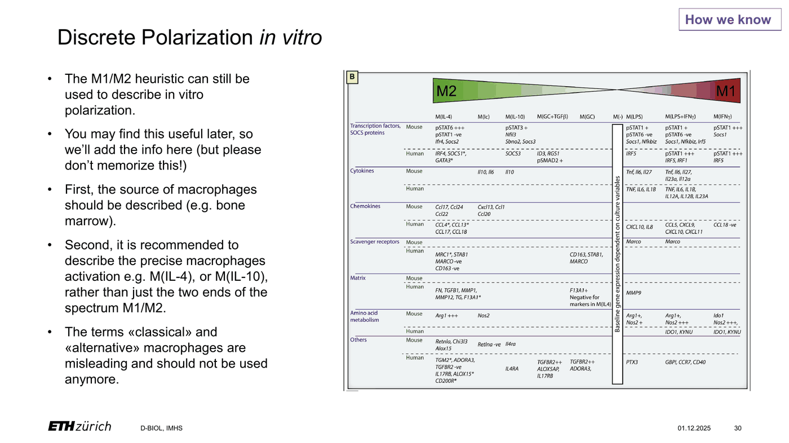

*Figure 8. Discrete polarization in vitro: the M(stimulus) table of Murray et al. 2014 (Immunity 41:14–20, Figure 1B), the reference for the states you will generate, and why the terms classical and alternative should not be used anymore (Immunology III, slide 30.)*

In this course you will generate four states and characterise them with readouts that
map onto the rows of that table:

| State | Stimulus | Expected readouts (mouse) |
|---|---|---|
| M(-) | medium | baseline |
| M(IFNγ) | IFNγ | Nos2, Irf1, Socs1; MHCII and CD86 up; primed for TLR responses |
| M(IL-4) | IL-4 | Arg1, Retnla, Chil3, Mrc1 (CD206); blunted TLR responses |
| M(IFNγ+LPS) | IFNγ + LPS | Tnf, Il6, Il1b, Nos2 strongly up; tolerance to re-stimulation with LPS |

Only M(IFNγ) is used as the "M1-like" state in the PRR challenge experiment, because
a state that already contains LPS will show endotoxin tolerance when re-stimulated.
The M(IFNγ+LPS) state is characterised but not re-challenged. If you want to see
tolerance, that is an extension challenge.

Why does the scheme fail in tissue (slide 16)? A macrophage in a mouse integrates its
ontogeny, its niche and many simultaneous signals, not one cytokine for 24 hours.
Single-cell RNA sequencing has made this visible: the states found in injured,
fibrotic, atherosclerotic, obese or tumour-bearing tissue are built from modules, and
one cell routinely co-expresses genes from both ends of the old axis. The best
studied example is a TREM2-positive, lipid-handling core programme with tissue- and
disease-specific modifiers, variously called lipid-associated, scar-associated,
fibrosis-associated, tumour-associated or NASH-associated macrophages. In the
peritoneal injury dataset you will analyse, the Trem2+ Spp1+ macrophages express
Arg1 next to Il1b. The lecture calls the replacement a modular spectrum model, and
the point of the in silico arm is that you see it in the data yourself.

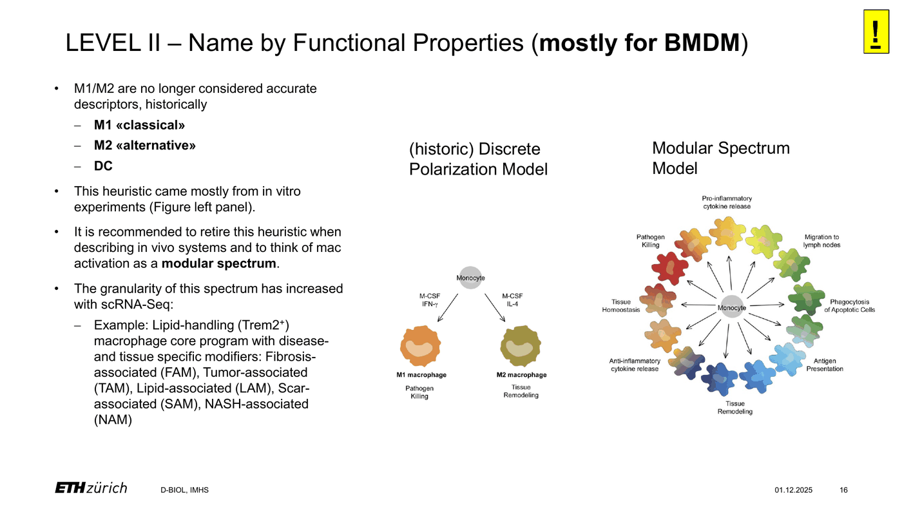

*Figure 9. Naming by functional properties: the historic discrete polarization model next to the modular spectrum model that replaces it (Immunology III, slide 16.)*

Questions. Name one gene that is "M1" in mouse and not in human. If a paper calls
tumour macrophages "M2", what exactly has it measured, and what has it assumed?
What would you call a RAW cell treated with IL-4 for 24 h, in the Murray
nomenclature?

## 5.5 What macrophages do all day

The lecture groups macrophage functions in homeostasis into four (slides 32–39), and
each of them appears somewhere in this course.

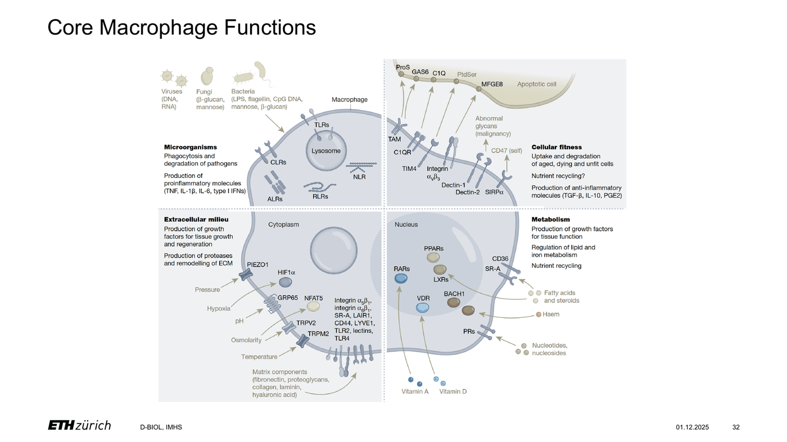

*Figure 10. The four core macrophage functions in homeostasis: microorganisms, extracellular milieu, cellular fitness and metabolism, with the receptors behind each (Immunology III, slide 32.)*

**Sensing danger.** Neutrophils are the better killers and dendritic cells the better
antigen presenters. The one thing macrophages do best is to detect that something is
wrong, with germline-encoded pattern-recognition receptors (slide 33). This is the
subject of the next section and of your challenge experiment.

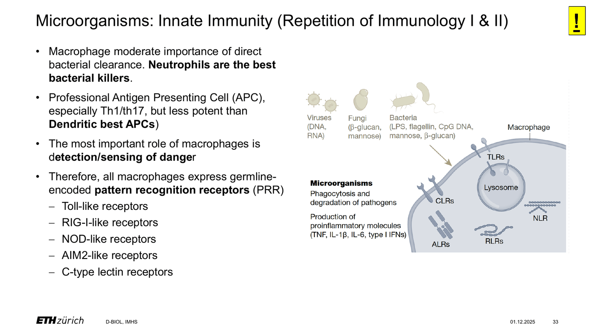

*Figure 11. Sensing danger: the pattern-recognition receptor families of the macrophage, TLR, CLR, NLR, RLR and ALR, and what they produce (Immunology III, slide 33.)*

**Safeguarding tissue structure.** Macrophages and fibroblasts form a reciprocal
circuit: the tissue provides CSF1, instruction and structure, the macrophage provides
growth factors such as PDGF, TGFβ and IGF1, proteases and their inhibitors, and
signals for inflammation and its resolution (slide 35; Zhou et al. 2018). Mechnikov
called macrophages sensors and healers. The tissue repair lectures showed where this
circuit sits in granulation tissue and remodelling.

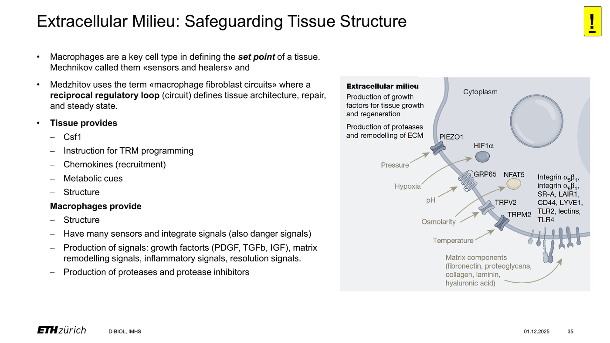

*Figure 12. Safeguarding tissue structure: what the tissue provides to the macrophage and what the macrophage provides to the tissue, the reciprocal circuit of Zhou et al. 2018 (Immunology III, slide 35.)*

**Efferocytosis.** Billions of cells die by apoptosis every day, and apoptotic cells
are almost never seen in healthy tissue because macrophages remove them without
inflammation. Healthy cells display CD47, a "don't eat me" signal read by SIRPα;
apoptotic cells expose phosphatidylserine, an "eat me" signal read by TIM4 among
others (slide 36). Efferocytosis releases TGFβ, IL-10 and PGE2 and suppresses TNF,
IL-1β and IL-6. TIM4 is in your flow panel as a marker of resident peritoneal
macrophages, and an efferocytosis assay is an optional extension.

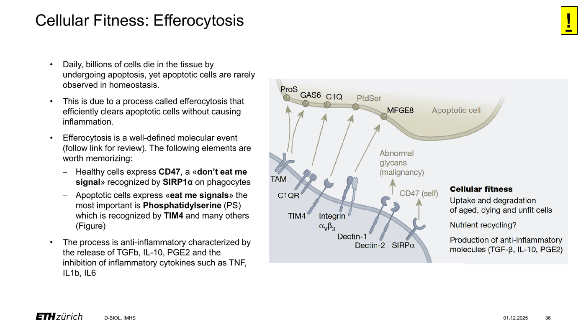

*Figure 13. Efferocytosis: CD47 as the don't-eat-me signal read by SIRPα, phosphatidylserine as the eat-me signal read by TIM4 and other receptors, and the anti-inflammatory outcome (Immunology III, slide 36.)*

**Metabolism.** Macrophages shape adipose tissue, support lipid storage through
PDGF-CC, control browning of white fat, and, when monocyte-derived and recruited in
obesity, drive insulin resistance (slide 39). The Trem2+ lipid-associated programme
from Section 5.4 was first described here.

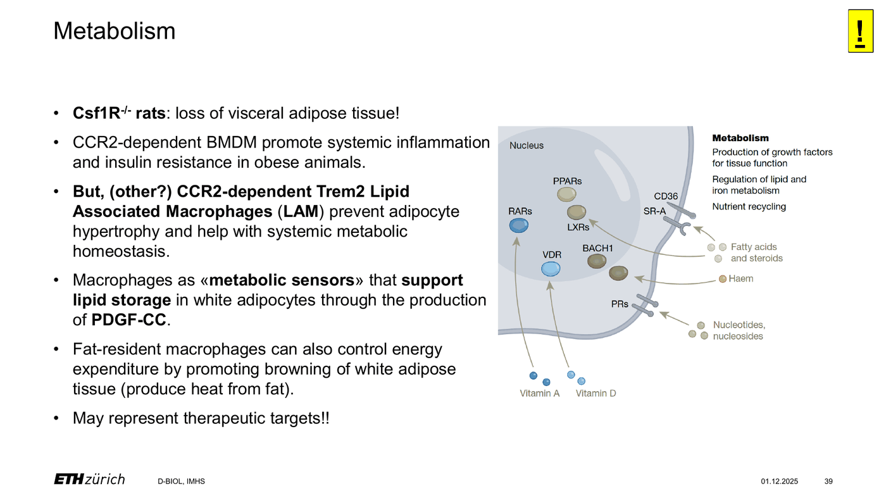

*Figure 14. Metabolism: macrophages as metabolic sensors in adipose tissue, from the Csf1r-deficient rat to Trem2+ lipid-associated macrophages (Immunology III, slide 39.)*

Questions. Which of the four functions is tested by an LPS challenge? Which one
is not tested by anything in this course, and how would you add it?

## 5.6 Sensing danger: pattern-recognition receptors

Charles Janeway proposed in 1989 that innate immune cells carry germline-encoded
receptors for conserved microbial patterns, before any such receptor was known.
Polly Matzinger added in 1994 that the immune system responds to danger, including
molecules released by the body's own damaged cells, not only to non-self. Both were
right. Medzhitov and Janeway cloned a human Toll-like receptor in 1997, and in 1998
Poltorak and colleagues showed that the LPS-unresponsive C3H/HeJ mouse carries a
mutation in Tlr4. The ligands are now called PAMPs when they come from microbes and
DAMPs when they come from damaged self, and the receptors PRRs. The families you
need are Toll-like receptors (TLR), C-type lectin receptors (CLR), NOD-like receptors
(NLR), RIG-I-like receptors (RLR) and AIM2-like receptors, plus the cGAS–STING
pathway for cytosolic DNA (slide 33, Figure 11).

The LPS pathway is the template for all of them. LPS is extracted from the bacterial
membrane by LPS-binding protein, handed to CD14, and presented to the TLR4–MD-2
complex on the cell surface. TLR4 dimerises and recruits MyD88, which activates
NF-κB and AP-1 within minutes and drives transcription of Tnf, Il6 and pro-Il1b. TLR4
is then internalised and signals through TRIF to IRF3, which induces type I
interferon. Pro-IL-1β is a special case: it is only released as mature IL-1β after a
second signal activates an inflammasome, which RAW cells cannot assemble. For that
reason IL-1β is read by qPCR in the extension, not by ELISA.

`[FIGURE 15: TLR4 signalling from the membrane to NF-κB and IRF3, adapted from a
review, e.g. Fitzgerald & Kagan 2020, Cell 180:1044.]`

The receptors behind the optional axes work by the same logic with different
adaptors and locations. TLR2 pairs with TLR1 to bind triacylated lipopeptides such as
Pam3CSK4 at the surface. TLR9 binds unmethylated CpG DNA, and TLR7 binds
single-stranded RNA and the small molecule R848, both in endosomes. Dectin-1, the
product of Clec7a, is a C-type lectin that binds β-glucan in zymosan and signals
through SYK and CARD9 to NF-κB; untreated zymosan also contains TLR2 ligands, which
is why the course uses depleted zymosan.

| Stimulus | Receptor | Course role | Readouts |
|---|---|---|---|
| LPS (E. coli O111:B4, ultrapure) | TLR4 | technical control for every group | IL-6, TNF, Nos2 |
| Pam3CSK4 | TLR1/2 | optional axis | IL-6, TNF; Tlr2 qPCR |
| CpG ODN 1826 | TLR9 | optional axis | IL-6, TNF; Tlr9 qPCR |
| Zymosan (depleted) | Dectin-1 | optional axis | IL-6, TNF; Clec7a qPCR |
| R848 | TLR7 | optional axis | IL-6, TNF; Tlr7 qPCR |

The question each group asks is whether polarization changes the receptor, the
output, or both. The expectation from the literature is asymmetric. IFNγ primes:
STAT1 raises the expression of TLR4, MD-2, CD14, MyD88 and several IRFs, so the
same dose of LPS produces more cytokine. IL-4 suppresses: STAT6 lowers TLR
responsiveness, partly through IRF4 competing with IRF5 at the MyD88 complex, so the
same dose produces less. Whether your receptor's transcript follows the same pattern
as the output is exactly what the qPCR extension shows, and the answer is not the
same for every receptor.

Endotoxin tolerance is the reason you do not re-challenge M(IFNγ+LPS). A macrophage
that has seen LPS reprogrammes itself within hours: a second dose produces a
fraction of the TNF and IL-6, while some other genes stay inducible (Biswas &
Lopez-Collazo 2009). It protects the organism from lethal cytokine release and it
ruins a naive experiment.

Questions. Draw the plate map for your axis with every control you need, and say
which control detects a contaminated reagent. Your IL-6 is lower in M(IL-4) than in
M(-). List three different mechanisms that could explain that, and say which readout
in your hands distinguishes them.

## 5.7 One niche up close: the peritoneal cavity

The lecture spends its second half on one niche, because it is the one this lab
studies (slides 17–30). The peritoneum, pleura and pericardium are the serosal
cavities, derived from the embryonic coelom, and lined by a monolayer of mesothelial
cells. The peritoneal fluid contains a free-floating population of immune cells, which
is why a lavage with a few millilitres of buffer gives you a tissue macrophage
population without any digestion.

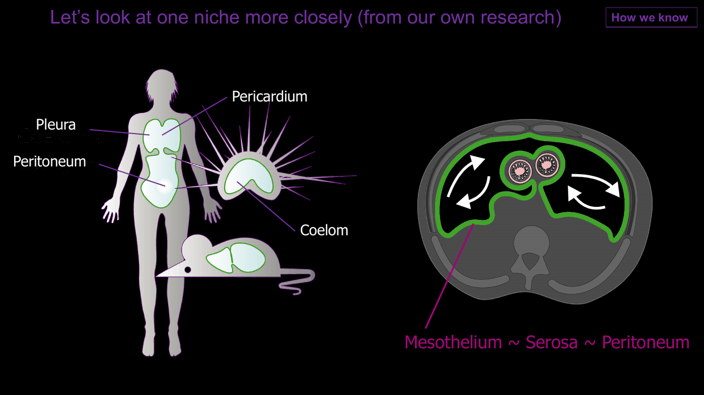

*Figure 16. The serosal cavities: peritoneum, pleura and pericardium, derived from the embryonic coelom and lined by mesothelium, in human and mouse (Immunology III, slide 17.)*

Two macrophage populations live there (Ghosn et al. 2010). Large peritoneal
macrophages (LPM) are F4/80 high, express ICAM2 (CD102) and TIM4, and depend on the
transcription factor GATA6, which is induced by retinoic acid produced in the
omentum (Okabe & Medzhitov 2014; Rosas et al. 2014; Gautier et al. 2014). They make
up roughly a third of the lavage cells in a young adult mouse. Small peritoneal
macrophages (SPM) are F4/80 low, MHCII high and monocyte-derived. The rest of the
lavage is B1 B cells, a few T and NK cells, mast cells and eosinophils. In the flow
panel, CD19 removes the B cells, F4/80 against MHCII separates the two macrophage
populations, and TIM4 with ICAM2 confirms the resident identity. No in vitro cell
will fall into the LPM gate. If you run the peritoneal cells extension, that is
its first result, before you have looked at a single activation marker.

What do LPMs do? In the steady state they drift through the cavity in undirected
migration (slide 27). On injury they act as extravascular platelets: within minutes
they aggregate on the wounded mesothelium, form clots with each other and with the
damaged surface, and seal the defect (Zindel et al. 2021, Science). This sudden
disappearance from the fluid was known for decades as the macrophage disappearance
reaction before intravital microscopy showed where the cells went. After larger
surgical injury, monocytes are recruited and differentiate into two states, a Folr2+
Selenop+ repair-associated and a Trem2+ Spp1+ scar-associated macrophage, with
intermediate cells between them (slide 29, Figure 19). The scar-associated cells drive the
formation of peritoneal adhesions, the fibrous bands that are the most frequent
long-term complication of abdominal surgery `[TODO: cite the Spp1 paper once
published]`. Bacterial contamination of the cavity, modelled by caecal ligation and
puncture, makes adhesions worse through EGFR signalling in the mesothelium (Zindel
et al. 2021, Nat Commun); this is the experiment behind the dataset in Section 5.9.

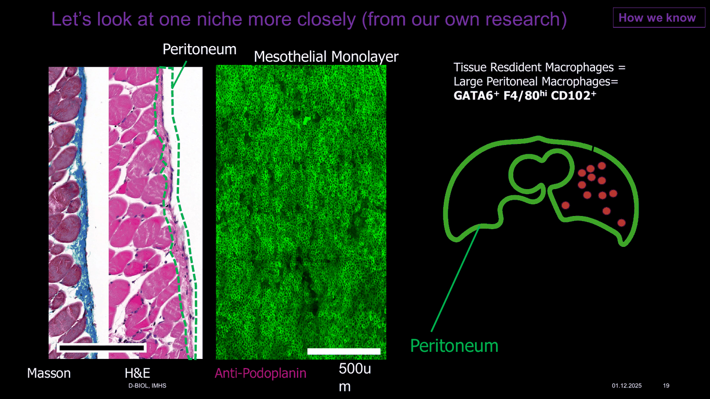

*Figure 17. The peritoneal niche in histology: Masson and H&E sections of the abdominal wall with the mesothelial monolayer, podoplanin staining of the mesothelium, and the GATA6+ F4/80 high CD102+ large peritoneal macrophages floating in the cavity (Immunology III, slide 19.)*

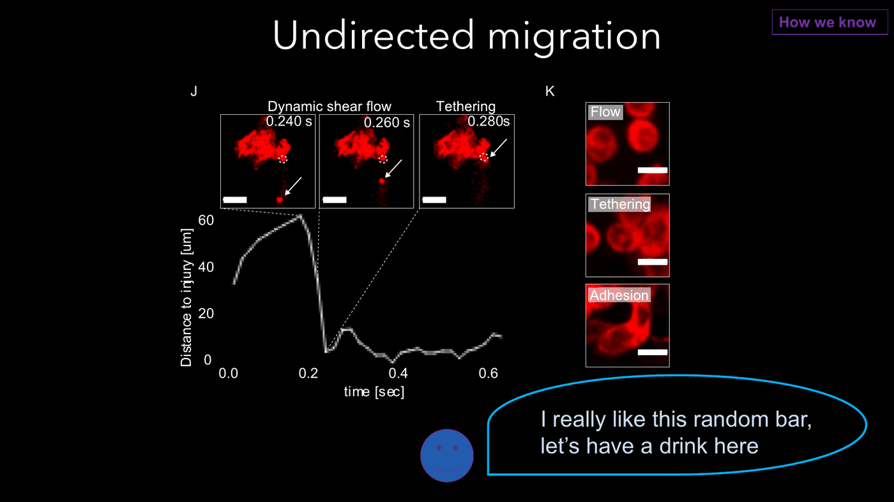

*Figure 18. Undirected migration: a large peritoneal macrophage drifting in dynamic shear flow, tethering and adhering, tracked by intravital microscopy (Immunology III, slide 27.)*

Questions. Why is a lavage a better in vivo comparison for your polarized cells
than a digested organ? What is lost in a digested organ that a lavage keeps? If a
mouse had surgery three days ago, how would its lavage differ from a healthy one?

## 5.8 Why a dish is not a body

The in vitro states are reproducible, mechanistically transparent and cheap, which is
why they fill the literature. The in vivo states are the ones that matter. The gap
between them has three sources, and you will meet all three.

First, ontogeny: a cell line or a BMDM has no embryonic history and no history in a
niche. Second, niche: the imprinting and survival signals of Section 5.3 are absent
from culture medium, and the lineage-determining factors are silent or ectopic. Third,
signal integration: a tissue macrophage reads dozens of signals at once, from matrix
stiffness to metabolites to neighbouring cells, and never one cytokine at one
concentration for 24 hours. None of this makes the dish useless. It makes the dish a
model, and a model has a domain of validity that has to be measured, not assumed.
Measuring it is the course.

Questions. Which of the three sources of the gap could you close in vitro, and how?
Which one can you not close?

## 5.9 The in silico dataset and how single-cell RNA sequencing works

GSE186658 (Zindel et al. 2021, Nat Commun, PMID 34916513) contains single-cell RNA
sequencing of mouse peritoneal injury sites 24 h after a surgical button injury, with
and without caecal ligation and puncture, two female C57BL/6 mice per condition. The
data are on GEO as Cell Ranger filtered matrices, one per mouse, in the three-file
format that Seurat reads directly: a list of barcodes, a list of genes, and a sparse
count matrix. The published analysis identified Gata6+ resident macrophages, Folr2+
Selenop+ repair-associated macrophages, Trem2+ Spp1+ scar-associated macrophages,
intermediate states, monocytes and dendritic cells (slide 29, Figure 19).

The method, in one paragraph. Tissue is digested into single cells, which are
captured one per droplet together with a bead carrying a cell barcode and millions of
unique molecular identifiers (UMIs). Reverse transcription inside the droplet tags
every mRNA with the barcode of its cell and a UMI of its own, so that after
sequencing each read can be assigned to a cell and PCR duplicates can be collapsed.
Cell Ranger aligns the reads and produces the count matrix: genes in rows, cells in
columns, UMIs as values, mostly zeros.

The analysis you will reproduce follows the standard Seurat workflow (Hao et al.
2021). Quality control removes barcodes with too few genes, likely empty droplets,
and barcodes with too many or with a high fraction of mitochondrial transcripts,
likely doublets or dying cells. Counts are normalised for sequencing depth and
log-transformed. The few thousand most variable genes are selected and reduced by
principal component analysis. Cells are connected into a nearest-neighbour graph in
principal component space and clustered by community detection. UMAP projects the
graph into two dimensions for display, and only for display: distances on a UMAP are
not measurements. Clusters are annotated by marker genes, which is where biology
enters. Macrophages are found by Adgre1, Cd68, Csf1r, Fcgr1 and Mertk; monocytes by
Ly6c2, Ccr2 and Plac8; dendritic cells by Flt3, Xcr1 and Ccr7; B cells by Cd79a; T
cells by Cd3e; mesothelial cells by Msln and Upk3b. Within the macrophages, the three
populations are separated by Gata6, Timd4 and Icam2, by Folr2, Selenop and Lyve1, and
by Trem2, Spp1, Cd9 and Lpl. Finally, each cell is scored for a gene signature by
comparing the mean expression of the signature genes with a matched random control
set; this is how you will ask every in vivo macrophage how M(IFNγ)-like and how
M(IL-4)-like it is.

The core in silico task is built on that last step. The M(IFNγ+LPS) and M(IL-4)
signatures are not taken from a textbook list; you derive them from a public bulk
RNA-seq dataset of RAW 264.7 cells and bone marrow-derived macrophages stimulated
with the same reagents you use at the bench (GSE113836, `[TODO: verify contents,
replicates and raw counts before the course]`). Every macrophage in the peritoneal
single-cell dataset is then scored against both signatures, and the question is how
much of the tissue population either signature explains. Integration of the tissue
cells with a true in vitro single-cell dataset (Sanin et al. 2022, Sci Immunol,
`[TODO: accession]`) is an extension, not the core. The teaching staff preprocess
both datasets and ship small, ready-to-load objects, so the dry lab never starts
from raw reads.

Two limitations matter for your interpretation. Enzymatic digestion under-represents
cells that are fragile or adherent, and large peritoneal macrophages are notoriously
lost, which is why the Gata6+ cluster is small in the data and large in a lavage.
And the dataset describes injured tissue at a single time point, so a state that is
absent at 24 h may dominate at day 7.

*Figure 19. The published UMAP of the peritoneal injury dataset: Gata6+ tissue-resident, Folr2+ Selenop+ repair-associated and Trem2+ Spp1+ scar-associated macrophages, intermediate macrophages, monocytes and dendritic cells, with the old M1 and M2 axes drawn across it (Immunology III, slide 29.)*

`[FIGURE 20: the single-cell workflow from tissue to count matrix to clusters,
adapted from a review or drawn by the lab.]`

Questions. Why is the Gata6+ cluster small in the sequencing data but large in a
lavage? What would a cell with a high M(IFNγ) score and a high M(IL-4) score mean
for the M1/M2 axis? A reviewer says "the two conditions are not integrated". What do
they mean, and how would you check?

## 5.10 Working with a language model as a scientist

You will use a large language model to install software, write and debug analysis
code, and probably to read papers. It will be fast and mostly right, and the mostly is
the problem. Language models invent functions that do not exist in a package, choose
default parameters silently, mis-state what a method assumes, and cite papers that
were never written. They do all of this in confident prose. The availability of
plausible text now outgrows the availability of verified claims by orders of magnitude
(Bergstrom & West 2020), and a scientist's job is to tell the two apart.

Three habits protect you. Run the code and look at the object, not at the model's
description of the object. Reproduce a known result before you trust a new one, which
is why the in silico challenge gives you code without figures. And write down every
error you catch, because the habit is the skill.

Questions. The model tells you that a Seurat function normalises "by default to
10,000 counts per cell". How do you check in under a minute? A citation the model
gave you has a real journal, a real year and a plausible author list. What else do
you need?

