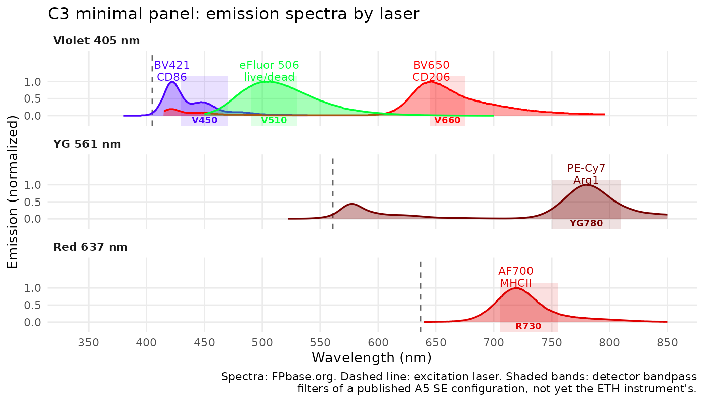
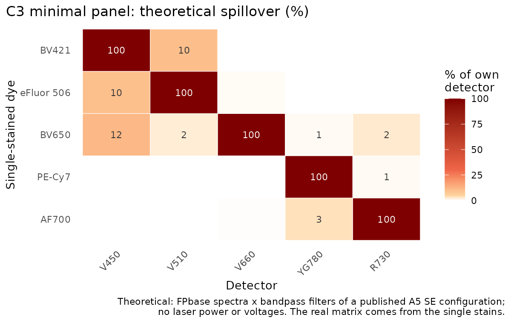

# C3 Flow cytometry of polarized J774A.1

> **Under construction.** This course runs for the first time in spring 2027 and is being built in the open. Interested students are welcome to apply and to give input ([contact](https://zindellab.ch/contact.html), [issues](https://github.com/TizzuLab/Blockrophage/issues)). **Please do not use these protocols in the lab yet.** Values are unverified until this notice is gone.

| | |
|---|---|
| ID | C3 |
| Used in | Exp 1 (core: polarized J774A.1 cells on the minimal panel, week 2); X02 (extension: peritoneal cells on the full panel, listed in X02) |
| Hands-on time | 3 h staining including fixation and permeabilization, 1 h acquisition |
| Wall-clock time | half a day; fixed samples can be acquired the next day |
| Resources | hood, cooled centrifuge with plate rotor, heating block, BD FACSymphony A5 SE slot reserved by the facility `[TODO: slot dates]`, FlowJo seat |
| Depends on | C2 unchallenged 6-well per state, 24 h after polarization |
| Lab SOP | Zindel lab "Flow cytometry" (v2.0, 2026-02-16) and "Flow cytometry antibody titration" (v1.0, 2025-08-22); panels in the lab's panel workbook (macrophage polarization panels, version 18.11.2026). The SOP wins over this page. |

## Purpose

Phenotype your group's polarization in week 2: the vehicle control, M(polarizer)
and the LPS control, harvested on Wednesday morning after about 19 h, stained and
fixed the same day, acquired on Thursday morning and gated in the FlowJo session on
Thursday afternoon. The LPS control must show CD86 and scatter up and the vehicle
control must not; only then does the polarizer's result count. Flow on challenged
cells (week 3) is an extension and needs a slot from the facility's regular booking
calendar.

The core runs a **minimal panel** of five colours on J774A.1 cells: a pure
macrophage line needs no lineage markers. Primary peritoneal cells in the extension
X02 run a sixteen-colour full panel, listed there; it carries these five colours on
the same fluorochromes, so in vitro and tissue cells can be compared directly in the
same session.

## Materials

Click the panel to open it. Copy the table straight into Excel, or download both
course panels as one workbook: [flow_panels.xlsx](flow_panels.xlsx). **lab** = in
the lab's stock, dilution from the lab's panel workbook (titrated with 1 × 10^6
cells in 50 µL); **order** = to order and titrate before the course. Detectors are
for the BD FACSymphony A5 SE.

<!-- The panel tables in C3 and X02 are the source. After editing them, rebuild the
     workbook: python3 stuff/tools/panels/flow_panels_xlsx.py
     and the spectra: Rscript code/flow/panel_spectra.R -->

<b>Minimal panel</b>: core, J774A.1, 5 colours + Fc block

Rows by laser: ⬛ UV 355 nm, 🟪 violet 405 nm, 🟦 blue 488 nm, 🟨 yellow-green 561 nm, 🟥 red 637 nm.

| Laser | Fluorochrome | Detector | Target | Purpose | Clone | Cat. no. | Compartment | Dilution | Status |
|---|---|---|---|---|---|---|---|---|---|
| 🟪 Violet 405 | BV421 | V450 | CD86 | M(IFNγ), LPS | GL-1 | BioLegend 105031 | surface | titrate | order |
| 🟪 Violet 405 | eFluor 506 | V510 | live/dead | exclude dead cells | n/a | Thermo 65-0866-18 | before fixation | 1:700 | lab |
| 🟪 Violet 405 | BV650 | V655 | CD206 (MMR) | M(IL-4) | C068C2 | BioLegend 141723 | intracellular | titrate | order |
| 🟨 YG 561 | PE-Cy7 | YG780 | Arginase 1 | M(IL-4) | A1exF5 | Thermo 25-3697-82 | intracellular | titrate | order |
| 🟥 Red 637 | AF700 | R730 | MHCII (I-A/I-E) | M(IFNγ) | M5/114 | Thermo 56-5321-82 | surface | 1:100 | lab |
| n/a | none | n/a | CD16/32 (Fc block) | block Fc receptors | n/a | BioLegend 101302 | surface | 1:100 | lab |

Spectra from [FPbase](https://www.fpbase.org) and filters of a published A5 SE
configuration, plotted by [code/flow/panel_spectra.R](../code/flow/panel_spectra.R).
The matrix is theoretical (no laser power, no voltages): it shows where to expect
spillover, BV421 into the live/dead detector here. The matrix you compensate with
comes from the single stains of the day.

> [!IMPORTANT]
> **To verify:** check every detector name against the facility's configuration of
> the A5 SE. A published A5 SE configuration (Cornell BRC, used for the shaded
> filter bands in the figure) has no V655; BV650 is read in V660 (660/30) there.
> Titrate CD86, CD206 and Arg1 before the course by stain index on a
> positive and a negative population (CD206 and Arg1 after fixation and
> permeabilization); the vendor suggests 0.5 µg per test for Arg1. CD86 GL-1 and
> CD206 C068C2 have been used on J774A.1 by flow (J Neuroinflammation 2020,
> doi:10.1186/s12974-020-01860-y); for Arg1 A1exF5 no J774A.1 flow data were found,
> so the IL-4 control decides. Pack sizes: CD86 105031 (125 µL) or 105032 (50 µg);
> Arg1 25-3697-82 (100 µg) or 25-3697-80 (25 µg).

Reagents:

- FACS buffer (the lab calls it "MACS buffer"), 500 mL: 478 mL PBS, 15 mL FCS
  (3%), 2 mL 0.5 M EDTA (2 mM), 5 mL 1 M HEPES (10 mM). Buffer recipes are in the
  protocol index.
- UltraComp eBeads compensation beads (Thermo 01-2222-42)
- eBioscience Foxp3 / Transcription Factor Staining Buffer Set (Thermo 00-5523-00)
  for fixation and permeabilization before the CD206 and Arg1 stain
- 96-well V-bottom plate (Faust 6091901), flow tubes with cell-strainer cap
- Trypan blue (Sigma T8154), Neubauer chamber or Countess III with slides (Thermo
  C10228)

## Before you start

- Cytometer slot confirmed: Thursday 25 March, two batches of 1.5 h, two groups
  each `[TODO: facility reservation]`. FlowJo session the same afternoon, teaching
  seats `[TODO: check with Florian Mair]`.
- Staining plan in the notebook: samples, unstained, live/dead control, single
  stains on beads, FMOs for CD86 and Arg1 (and for MHCII and CD206 if the wells
  allow).
- Cells harvested by scraping into cold FACS buffer and counted: at least
  0.5 × 10^6 cells per stain (the antibodies were titrated with 1 × 10^6).
- Work on ice or at 4 °C until fixation; heating block at 95 °C for the live/dead
  control.

## Procedure

Staining order: Fc block and live/dead, then the surface antibodies (CD86, MHCII),
then fixation and permeabilization, then the intracellular antibodies (CD206, Arg1).

1. Harvest the 6-well of each condition (vehicle, polarizer, LPS control) by
   scraping into cold FACS buffer.
   Count. Centrifuge **`300 × g, 5 min, 4 °C`**.
2. Resuspend each sample in 200 µL PBS and transfer to the V-bottom plate.
3. Live/dead control: take 100 µL of one sample into a tube, **`95 °C, 5 min`**, then
   **`on ice, 5 min`**, and add it back to the remaining 100 µL of live cells of that
   well. This well is stained with the viability dye only.
4. Wash all wells with 200 µL PBS; centrifuge **`300 × g, 5 min, 4 °C`**; flick the plate
   to discard the supernatant (the same wash from here on).
5. Viability dye plus Fc block, 50 µL per well in PBS, **`20 min, 4 °C, dark`**.
   Unstained well gets 50 µL PBS. Wash with PBS.

> [!NOTE]
> In PBS, not in buffer: serum quenches the dye.

6. Surface stain: CD86 and MHCII in FACS buffer, 50 µL per well,
   **`20 min, 4 °C, dark`**. Unstained and live/dead wells get buffer only. FMO wells
   get the mix minus one antibody.
7. Single stains for compensation on beads, in parallel: vortex the beads 30 s, one
   drop (about 30 µL) made up to 400 µL with buffer serves four wells of 100 µL;
   add 1 µL of one antibody per well, plus one well of beads without antibody.
   **`20 min, 4 °C, dark`**. The viability dye is compensated on the heat-killed
   live/dead well, not on beads.
8. Wash all wells twice with FACS buffer.
9. Fix and permeabilize with the Foxp3 buffer set, following the kit insert:
   fixation/permeabilization working solution (1 part concentrate in 4 parts
   diluent), 100 µL per well, **`30 min, 4 °C, dark`**; wash twice with 1×
   permeabilization buffer. Put the PE-Cy7 (Arg1) single-stain beads through the
   same fixation and permeabilization.

> [!WARNING]
> PE-Cy7 is a tandem dye: fixation and light change its spillover. Compensate it
> with the same A1exF5 lot treated exactly like the samples, and keep everything
> dark from here on.

10. Intracellular stain: CD206 and Arg1 in permeabilization buffer, 50 µL per well,
    **`30 min, 4 °C, dark`** `[TODO: times from the kit insert; confirm at titration]`.
    FMO wells get the mix minus one antibody. Wash twice with permeabilization
    buffer.

> [!NOTE]
> CD206 is stained after permeabilization on purpose: surface levels on mouse
> macrophages are low, and the intracellular stain catches the surface and the
> intracellular pool together.

11. Resuspend in 200 µL FACS buffer and filter through the strainer cap into flow
    tubes. Keep on ice in the dark; fixed samples can be acquired the next day.
12. Acquire on the A5 SE with the compensation controls recorded in the same
    session. Record at least 10,000 live single cells per sample
    `[TODO: confirm with the facility]`.
13. Export FCS files named with group, date, sample.

## Controls

- Unstimulated vs IL-4 (Arg1 and CD206 up) vs LPS/IFN-γ (CD86 and MHCII up).
- Unstained and single-stain beads for compensation; the PE-Cy7 beads fixed and
  permeabilized like the samples; the heat-killed live/dead well for the viability
  gate.
- FMO for CD86 and Arg1: the markers that carry the result. FMO for MHCII and
  CD206 if the wells allow; FMOs for the intracellular markers are permeabilized
  like the samples.
- M(-) as the reference state.

## Checkpoints

- Viability above 80% in the vehicle well; the LPS control may be lower.
- LPS control: CD86 up, FSC and SSC up, compared with the vehicle well. If not, the
  staining or the cells failed and the polarizer is not judged on this run.
- MHCII and CD86 higher in M(IFNγ) than M(-), CD206 higher in M(IL-4): if neither
  moves, check the stimulation before the staining.
- Arg1 shows at most a small shift in M(IL-4): the induction is reliable at the
  mRNA level and modest as protein, and J774A.1 still has to show it. The FMO
  decides whether it is real. No shift is a result, not a failure.

## Known failure modes

- The cells clump after scraping: the EDTA in the buffer helps; filter through the
  strainer cap and pipette gently.
- Autofluorescence in activated cells: use the FMOs, not the unstained control, to
  set gates.
- Dim viability stain: dye diluted in buffer instead of PBS.
- BV421 (CD86) spills into V510 (live/dead): minor, the live/dead separation
  tolerates it. No dye sits in the PE or AF488 detectors in the minimal panel, so
  the PE-Cy7 leak into PE and the blue autofluorescence of macrophages do not
  touch any marker.
- Surface signal drops after permeabilization: expected to a degree; set the CD86
  and MHCII gates on FMOs that went through the same fixation.
- Arg1 compensation off: the PE-Cy7 single stain was not fixed and permeabilized,
  or came from another lot.

## Output

FCS files, compensation matrix, staining plan. Gating in FlowJo (licences from the
facility `[TODO: confirm seats and whether they run on student laptops]`); export
gated population statistics as CSV into the notebook. Do not try to gate in R.
