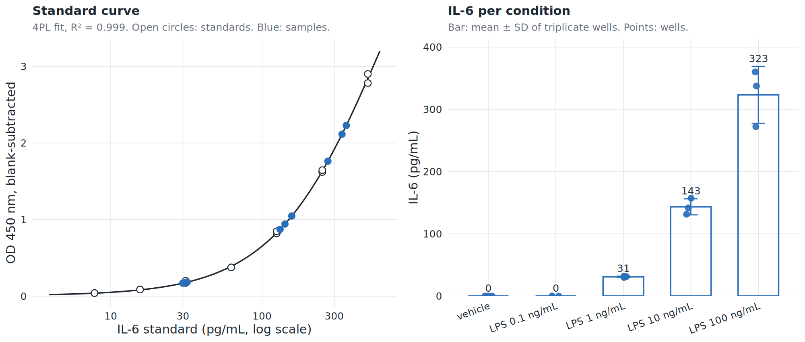

# P06 ELISA for IL-6 and TNF

> **Under construction.** This course runs for the first time in spring 2027 and is being built in the open. Interested students are welcome to apply and to give input ([contact](https://zindellab.ch/contact.html), [issues](https://github.com/TizzuLab/blockrophage-course/issues)). **Please do not use these protocols in the lab yet.** Values are unverified until this notice is gone.

| | |
|---|---|
| ID | P06 |
| Used in | Exp 2 |
| Hands-on time | 3–4 h, with incubation waits, plus coating the day before |
| Wall-clock time | 2 days (coating overnight) |
| Resources | plate reader (450 nm; the lab uses a Promega GloMax Discover), multichannel pipette, plate washer or wash bottle, bench space |
| Depends on | P05 supernatants (16 h arm) |
| Lab SOP | Zindel lab "RAW 264.7 polarisation" (v1.0, 2025-12-08), harvesting section, and the kit insert of the Invitrogen Mouse IL-6 Uncoated ELISA Kit (88-7064-88). The kit insert wins over this page. |

## Purpose

Quantify IL-6 and TNF in the challenge supernatants. These are the NF-κB outputs of
the TLR pathway and the main readout of whether polarization primes or suppresses
the response.

## Materials

- Mouse IL-6 Uncoated ELISA Kit (Invitrogen 88-7064-88): capture and detection
  antibodies, standard, coating buffer, assay diluent, streptavidin-HRP, TMB, stop
  solution. Standard range 7.8 to 500 pg/mL.
- Mouse TNF ELISA kit `[TODO: the lab has run IL-6 only; choose the matching
  uncoated TNF kit of the same series]`
- High-binding 96-well ELISA plates (Nunc MaxiSorp or as the kit recommends)
- Supernatants from P05, cleared at 900 × g, or thawed aliquots on ice
- Complete medium for diluting samples where needed
- Plate reader at 450 nm. The kit recommends subtracting a 570 nm reading; the lab's
  GloMax Discover reads 450 nm without a reference filter, which worked for the
  example below.

## Before you start

- Kit insert read once completely. Coat the plate with capture antibody the day
  before (overnight at 4 °C), block it in the morning while P05 harvests.
- Plate map for the ELISA plate drawn in the notebook: standard curve in duplicate
  (7 points, 2-fold from 500 pg/mL, plus blank), samples in the layout of the
  culture plate, dilutions.
- Dilution: with the 96-well format of P05 (2 × 10^4 cells, 200 µL, 16 h) the neat
  supernatant of LPS-challenged M(-) lands inside the standard range (about
  300 pg/mL at 100 ng/mL LPS in the lab's hands). Run every sample neat on the
  first plate; add a 1:5 dilution in assay diluent for the M(IFNγ)-primed LPS wells,
  which may run higher. Use the dilution that lands in range for the rest.

## Procedure

1. Follow the kit insert step by step. In outline: coat 100 µL capture antibody
   per well overnight at 4 °C; wash; block 1 h at room temperature; wash; add
   100 µL standard or sample per well, 2 h at room temperature; wash; detection
   antibody 1 h; wash; streptavidin-HRP 30 min; wash; TMB about 15 min in the dark;
   stop solution. Washes are 3 to 5 times with the kit's wash buffer; do not let
   wells dry.
2. Standard curve: 2-fold series from 500 pg/mL in assay diluent, duplicate,
   7 points plus blank (0 pg/mL).
3. Samples at the dilutions from the plate map.
4. Read at 450 nm (with 570 nm reference if the reader has it) within the time the
   kit specifies after the stop solution.
5. Export the raw absorbance table, named with group, date, plate, analyte, and
   write a tidy CSV with one row per well (see the worked example for the columns).

## Controls

- Blank (0 pg/mL standard): background, subtracted from every well.
- LPS on M(-): the positive control shared by all groups.
- Medium-only well from P02 run as a sample: detects reagent contamination.

## Checkpoints

- The standard curve is monotonic and the top standard is below saturation of the
  reader (the lab's top standard reads about OD 2.9, close to the ceiling; do not
  extend the curve upward).
- At least one dilution of every sample falls inside the standard range; otherwise
  rerun that sample at another dilution.

## Known failure modes

- Samples above the top standard: dilute more.
- High blank: insufficient washing or contaminated diluent.
- Edge wells drifting: evaporation during incubation; cover the plate.
- Values at or below the lowest standard (unstimulated wells): a real result, not a
  failure. Report them as "below 7.8 pg/mL".

## Worked example: IL-6 after an LPS dose ladder

In September 2026 the lab stimulated RAW 264.7 (2 × 10^4 cells per 96-well, 200 µL,
16 h) with vehicle or 0.1, 1, 10 and 100 ng/mL LPS in triplicate, cleared the
supernatants and ran the IL-6 kit above with a 500 to 7.8 pg/mL standard in
duplicate, read at 450 nm. The raw ODs are in
[`code/elisa/example_data/il6_lps_raw264_2026-09.csv`](../code/elisa/example_data/il6_lps_raw264_2026-09.csv)
and the analysis is [`code/elisa/elisa_standard_curve.R`](../code/elisa/elisa_standard_curve.R).



What you see: the standard curve is close to linear over the kit range and a
four-parameter logistic fit describes it (R² 0.999). Vehicle and 0.1 ng/mL LPS are
below the lowest standard, 1 ng/mL gives about 30 pg/mL, 10 ng/mL about 140 pg/mL
and 100 ng/mL about 320 pg/mL, with triplicate wells within 15%. The 100 ng/mL
point is the LPS control of P05: a neat supernatant lands in the upper third of the
curve, which is where you want it.

Run it yourself from the `code/elisa` folder:

```
Rscript elisa_standard_curve.R                      # example data
Rscript elisa_standard_curve.R my_plate.csv output  # your own plate
```

The script subtracts the blank, fits the standard curve (4PL, with a log-log linear
fallback that it announces), back-calculates every sample with its dilution factor,
flags wells outside the standard range, and writes `elisa_results.csv`,
`elisa_summary.csv` and the figure. Your CSV needs the columns `well`, `type`
(standard or sample), `condition`, `standard_pg_ml`, `replicate`, `od450` and
`dilution_factor`.

## Output

Raw export, the tidy CSV, the ELISA plate map, dilution factors per sample, and the
results files from the script. Concentrations are reported in pg/mL; where cell
numbers differ between wells, normalise per cell.
