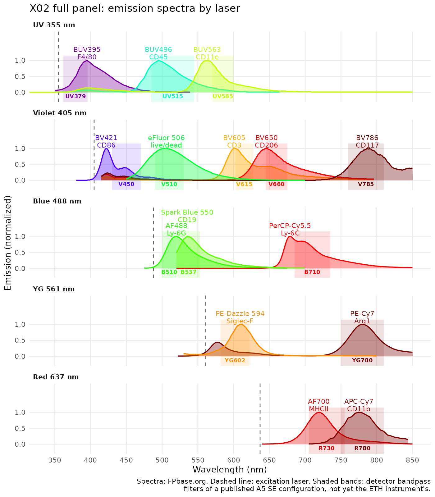
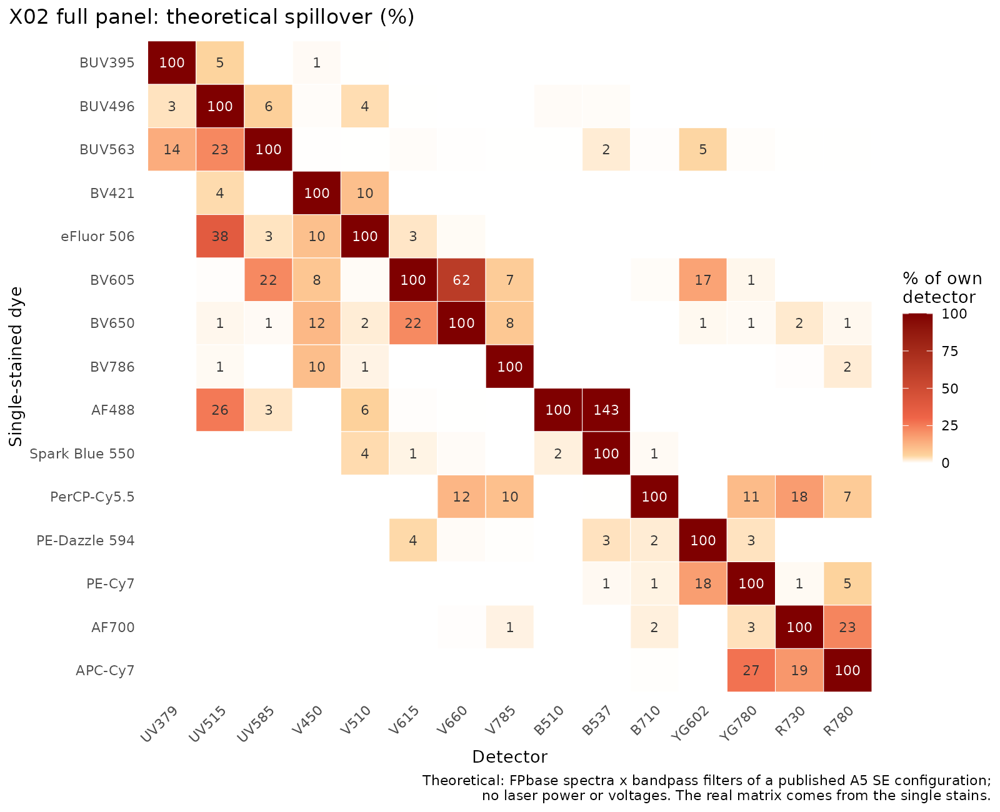

# X02 Peritoneal cells on the shared flow panel (extension)

> **Under construction.** This course runs for the first time in spring 2027 and is being built in the open. Interested students are welcome to apply and to give input ([contact](https://zindellab.ch/contact.html), [issues](https://github.com/TizzuLab/Blockrophage/issues)). **Please do not use these protocols in the lab yet.** Values are unverified until this notice is gone.

> Extension. Depends on primary material: we may be able to provide peritoneal
> lavage cells that are surplus from ongoing experimental work in the lab. Whether
> and when such a suspension is available is decided with your supervisor on the
> first afternoon; the cells arrive ready, on ice, as a suspension.

| | |
|---|---|
| ID | X02 |
| Used in | Extension |
| Hands-on time | 30 min receiving, counting and lysis, then staining as C3 |
| Wall-clock time | half a day, coordinated with a cytometer slot |
| Resources | ice, cooled centrifuge, counter, cytometer slot |
| Depends on | C3 staining procedure, the full panel below and a reserved cytometer slot; polarized J774A.1 cells ready on the same day; a surplus peritoneal cell suspension provided by staff |
| Lab SOP | Zindel lab "Flow cytometry" (v1.2) and "Flow cytometry antibody titration" for the staining; the SOP wins over this page. |

## Purpose

Run resident tissue macrophages, obtained without digestion, on the shared panel in
the same session as the polarized J774A.1 cells. The first result, before any
activation marker, is that no in vitro cell falls into the large-peritoneal-
macrophage gate.

## Materials

- FACS buffer, ice-cold: PBS, 3% FCS, 2 mM EDTA, 10 mM HEPES (recipe in the
  protocol index)
- 15 mL or 50 mL tubes, labelled, on ice
- ACK erythrocyte lysis buffer if the suspension is bloody (recipe in the protocol
  index)
- Counter, FACS reagents as in C3

Full panel: the five colours of the C3 minimal panel on the same fluorochromes,
plus lineage markers. Click to open; copy into Excel or download
[flow_panels.xlsx](flow_panels.xlsx). **lab** = in the lab's stock, dilution from
the lab's panel workbook; **order** = to order and titrate before the course.
Detectors are for the BD FACSymphony A5 SE.

<b>Full panel</b>: primary peritoneal cells, 16 colours + Fc block

Rows by laser: ⬛ UV 355 nm, 🟪 violet 405 nm, 🟦 blue 488 nm, 🟨 yellow-green 561 nm, 🟥 red 637 nm.

| Laser | Fluorochrome | Detector | Target | Purpose | Clone | Cat. no. | Compartment | Dilution | Status |
|---|---|---|---|---|---|---|---|---|---|
| ⬛ UV 355 | BUV395 | UV379 | F4/80 | macrophages | T45-2342 | BD 565614 | surface | 1:150 | lab |
| ⬛ UV 355 | BUV496 | UV515 | CD45 | leukocytes | I3/2 | BD 752411 | surface | 1:300 | lab |
| ⬛ UV 355 | BUV563 | UV585 | CD11c | dendritic cells | N418 | BD 749040 | surface | 1:200 | lab |
| 🟪 Violet 405 | BV421 | V450 | CD86 | M(IFNγ), LPS | GL-1 | BioLegend 105031 | surface | titrate | order |
| 🟪 Violet 405 | eFluor 506 | V510 | live/dead | exclude dead cells | n/a | Thermo 65-0866-18 | before fixation | 1:700 | lab |
| 🟪 Violet 405 | BV605 | V585 | CD3 | T cells (exclude) | 17A2 | BioLegend 100237 | surface | 1:100 | lab |
| 🟪 Violet 405 | BV650 | V655 | CD206 (MMR) | M(IL-4) | C068C2 | BioLegend 141723 | intracellular | titrate | order |
| 🟪 Violet 405 | BV786 | V785 | CD117 (c-Kit) | mast cells (exclude) | ACK2 | BD 752699 | surface | 1:200 | lab |
| 🟦 Blue 488 | AF488 | B510 | Ly-6G | neutrophils (exclude) | 1A8 | BioLegend 127625 | surface | titrate | order |
| 🟦 Blue 488 | Spark Blue 550 | B537 | CD19 | B cells (exclude) | `[TODO]` | BioLegend 115566 | surface | 1:400 | lab |
| 🟦 Blue 488 | PerCP-Cy5.5 | B710 | Ly-6C | monocytes | HK1.4 | Thermo 45-5932-82 | surface | 1:200 | lab |
| 🟨 YG 561 | PE-Dazzle 594 | PE-Texas Red | CD170 (Siglec-F) | eosinophils (exclude) | S17007L | BioLegend 155529 | surface | 1:300 | lab |
| 🟨 YG 561 | PE-Cy7 | YG780 | Arginase 1 | M(IL-4) | A1exF5 | Thermo 25-3697-82 | intracellular | titrate | order |
| 🟥 Red 637 | AF700 | R730 | MHCII (I-A/I-E) | M(IFNγ); small peritoneal macrophages | M5/114 | Thermo 56-5321-82 | surface | 1:100 | lab |
| 🟥 Red 637 | APC-Cy7 | R780 | CD11b | myeloid cells | M1/70 | BioLegend 101226 | surface | 1:400 | lab |
| n/a | none | n/a | CD16/32 (Fc block) | block Fc receptors | n/a | BioLegend 101302 | surface | 1:100 | lab |

Spectra from [FPbase](https://www.fpbase.org) and filters of a published A5 SE
configuration, plotted by [code/flow/panel_spectra.R](../code/flow/panel_spectra.R).
The matrix is theoretical (no laser power, no voltages); the one you compensate with
comes from the single stains of the day. Read it for the hot spots: AF488 puts more
light into B537 (Spark Blue 550) than into its own B510, BV605 spills 62% into V660
(BV650, CD206), APC-Cy7 shows up in YG780 (PE-Cy7, Arg1), and eFluor 506 is excited
by the UV laser and lands in UV515 (BUV496, CD45).

Changes from the lab's earlier sheet: Ly-6G moves from PE-Cy7 to AF488 and from
clone RB6-8C5 (Gr-1, binds Ly-6G and Ly-6C) to the Ly-6G-specific 1A8, the better
partner for Ly-6C HK1.4; Arg1 takes PE-Cy7, CD86 BV421, CD206 BV650. The PE
detector stays empty.

> [!IMPORTANT]
> **To verify:** check every detector name against the facility's configuration of
> the A5 SE. The published A5 SE configuration used for the figure has no V585,
> V655 or "PE-Texas Red" detector: there BV605 goes to V615 (615/25) or V595,
> BV650 to V660 (660/30) and PE-Dazzle 594 to YG602 (602/40). Before Ly-6G is
> ordered, look hard at AF488 against Spark Blue 550: with B510 at 510/20 and B537
> at 537/32, more AF488 light falls into B537 than into its own detector
> (theoretical, see the spillover matrix above).
> They mark different cells and both serve as exclusion gates, so it can work, but
> a Ly-6G dye on another laser may be the cleaner choice. Titrate Ly-6G on cells with
> neutrophils (pack sizes 127625, 25 µg, or 127626, 100 µg); CD86, CD206 and Arg1
> are titrated for C3.

## Before you start

- Confirm with your supervisor that a surplus suspension is available on a day
  with a cytometer slot, and that your polarized J774A.1 cells are ready the same day.
- C3 staining plan extended with the peritoneal samples on the full panel, and one
  well of each polarized J774A.1 state stained with the full panel too, so the
  overlay has F4/80 and the lineage markers.
- Record what the staff tell you about the sample: source of the material, date,
  volume, any treatment it carries over from the experiment it came from.

## Procedure

1. Receive the suspension on ice.

> [!WARNING]
> Keep it cold from here on; peritoneal macrophages adhere to plastic within
> minutes at room temperature.

2. Centrifuge **`300 × g, 5 min, 4 °C`**. If the pellet is red, resuspend in 1 mL ACK
   buffer, **`room temperature, 2 min`**, top up with buffer and centrifuge again.
3. Resuspend in FACS buffer and count. Expect large peritoneal macrophages to be
   roughly a third of the cells in a healthy sample.
4. Stain with the full panel (below; procedure as in C3), surface first, then fixation, permeabilization
   and the intracellular CD206 and Arg1 stain, and acquire in the same session as
   the polarized J774A.1 cells.
5. Gate: live single CD45+ cells; remove T cells (CD3), B cells (CD19),
   neutrophils (Ly-6G), eosinophils (Siglec-F) and mast cells (CD117); then
   CD11b+ cells, F4/80 against MHCII for large (F4/80 high, MHCII low) and small
   (F4/80 low, MHCII high) peritoneal macrophages; Ly-6C marks monocytes and CD11c
   dendritic cells. Read CD86, CD206 and Arg1 on the macrophage gates, and overlay
   the polarized J774A.1 cells on the same gates.

> [!WARNING]
> Neutrophils express Arg1 too. Gate Ly-6G+ cells out before you read Arg1 on
> macrophages.

## Controls

- The lineage gates (CD3, CD19, Ly-6G, Siglec-F, CD117) remove non-macrophages;
  F4/80 against MHCII separates large and small peritoneal macrophages.
- Same single-stain and fluorescence-minus-one controls as C3; the peritoneal
  sample and the J774A.1 cells share the compensation.

## Checkpoints

- A clear F4/80 high, MHCII low population exists in the peritoneal sample before
  anything else is interpreted; if it is missing, note the sample history and ask.

## Known failure modes

- Low cell number: the suspension was small or lost cells on the way; stain what
  you have and reduce the panel rather than the cell number per tube.
- Bloody suspension: lyse the erythrocytes and note it.
- Ly-6G and CD19 smear into each other: AF488 and Spark Blue 550 overlap on the
  blue laser. They mark different cells, so both work as exclusion gates; check
  the single stains and the compensation before blaming the sample.
- AF700 (MHCII) and APC-Cy7 (CD11b) are both bright on macrophages and neighbours
  on the red laser: compensate with care, and set the F4/80 against MHCII gate on
  FMOs.
- Few large peritoneal macrophages: prior inflammation in the experiment the sample
  came from; record the sample history and treat the result as a finding.

## Output

Cell counts, sample metadata as provided by staff, FCS files, and the gated
statistics side by side with the J774A.1 samples.
