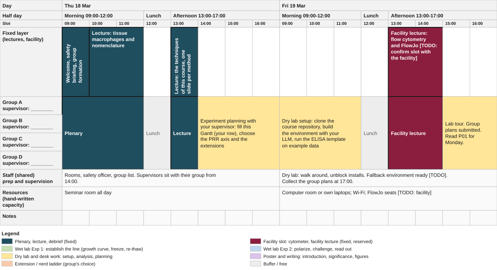
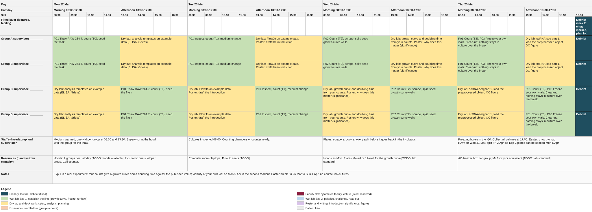
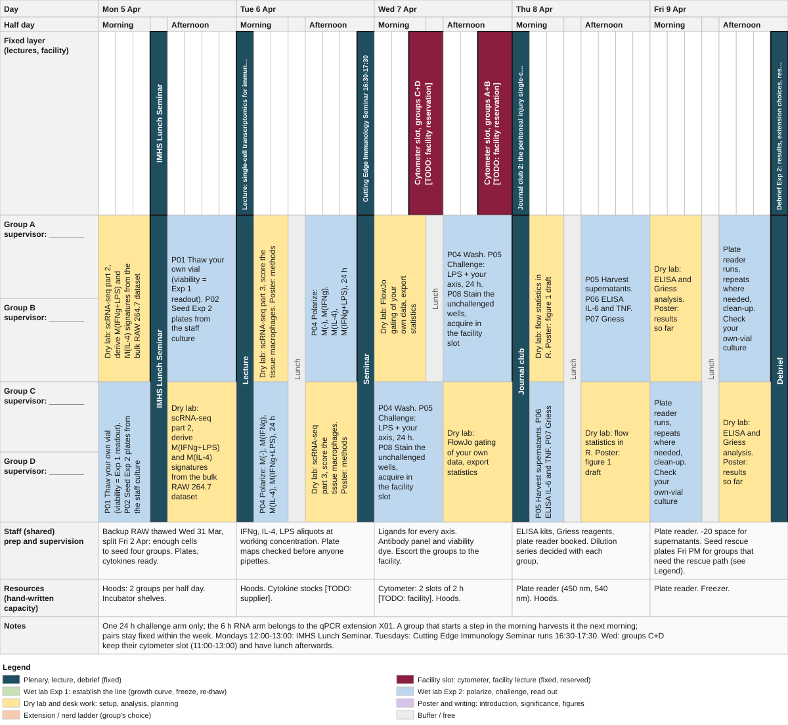
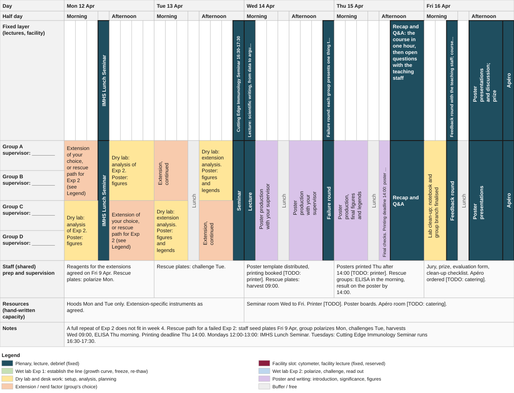

# Schedule (mirror of the Gantt workbook)

Generated from `Blockcourse_Gantt_FS2027.xlsx` by `tools/xlsx2md.py`. Do not edit; edit the workbook and rerun.
Activity blocks in brackets. The fixed layer is drawn by staff; group rows are the groups' own plans.

> **Under construction.** First run spring 2027; this is a template, not a confirmed timetable.

## Week 1: orientation (Thu 18 - Fri 19 March 2027), 09:00-17:00

Text version (what the companion reads)

### Thu 18 Mar

| | Morning 09:00-12:00 | Lunch 12:00-13:00 | Afternoon 13:00-17:00 |
|---|---|---|---|
| Fixed layer (lectures, facility) | [Plenary, lecture, debrief] Welcome, safety briefing, group formation; [Plenary, lecture, debrief] Lecture: tissue macrophages and nomenclature | - | [Plenary, lecture, debrief] Lecture: the techniques of this course, one slide per method |
| Group A supervisor: ________ | [Plenary, lecture, debrief] Plenary | Lunch | [Plenary, lecture, debrief] Lecture; [Dry lab and desk work] Experiment planning with your supervisor: fill this Gantt (your row), choose the PRR axis and the extensions |
| Group B supervisor: ________ | [Plenary, lecture, debrief] Plenary | Lunch | [Plenary, lecture, debrief] Lecture; [Dry lab and desk work] Experiment planning with your supervisor: fill this Gantt (your row), choose the PRR axis and the extensions |
| Group C supervisor: ________ | [Plenary, lecture, debrief] Plenary | Lunch | [Plenary, lecture, debrief] Lecture; [Dry lab and desk work] Experiment planning with your supervisor: fill this Gantt (your row), choose the PRR axis and the extensions |
| Group D supervisor: ________ | [Plenary, lecture, debrief] Plenary | Lunch | [Plenary, lecture, debrief] Lecture; [Dry lab and desk work] Experiment planning with your supervisor: fill this Gantt (your row), choose the PRR axis and the extensions |
| Staff (shared) prep and supervision | Rooms, safety officer, group list. Supervisors sit with their group from 14:00. | (same as previous column) | (same as previous column) |
| Resources (hand-written capacity) | Seminar room all day | (same as previous column) | (same as previous column) |

### Fri 19 Mar

| | Morning 09:00-12:00 | Lunch 12:00-13:00 | Afternoon 13:00-17:00 |
|---|---|---|---|
| Fixed layer (lectures, facility) | - | - | [Facility slot] Facility lecture: flow cytometry and FlowJo [TODO: confirm slot with the facility] |
| Group A supervisor: ________ | [Dry lab and desk work] Dry lab setup: clone the course repository, build the environment with your LLM, run the ELISA template on example data | Lunch | [Facility slot] Facility lecture; [Dry lab and desk work] Lab tour. Group plans submitted. Read P01 for Monday. |
| Group B supervisor: ________ | [Dry lab and desk work] Dry lab setup: clone the course repository, build the environment with your LLM, run the ELISA template on example data | Lunch | [Facility slot] Facility lecture; [Dry lab and desk work] Lab tour. Group plans submitted. Read P01 for Monday. |
| Group C supervisor: ________ | [Dry lab and desk work] Dry lab setup: clone the course repository, build the environment with your LLM, run the ELISA template on example data | Lunch | [Facility slot] Facility lecture; [Dry lab and desk work] Lab tour. Group plans submitted. Read P01 for Monday. |
| Group D supervisor: ________ | [Dry lab and desk work] Dry lab setup: clone the course repository, build the environment with your LLM, run the ELISA template on example data | Lunch | [Facility slot] Facility lecture; [Dry lab and desk work] Lab tour. Group plans submitted. Read P01 for Monday. |
| Staff (shared) prep and supervision | Dry lab: walk around, unblock installs. Fallback environment ready [TODO]. Collect the group plans at 17:00. | (same as previous column) | (same as previous column) |
| Resources (hand-written capacity) | Computer room or own laptops; Wi-Fi; FlowJo seats [TODO: facility] | (same as previous column) | (same as previous column) |

## Week 2: Exp 1, establish the line (Mon 22 - Thu 25 March 2027)

Text version (what the companion reads)

### Mon 22 Mar

| | Morning 09:00-12:00 | Lunch 12:00-13:00 | Afternoon 13:00-17:00 |
|---|---|---|---|
| Fixed layer (lectures, facility) | - | [Plenary, lecture, debrief] IMHS Lunch Seminar | - |
| Group A supervisor: ________ | [Wet lab Exp 1] P01 Thaw RAW 264.7, count (T0), seed the flask | [Plenary, lecture, debrief] IMHS Lunch Seminar | [Dry lab and desk work] Dry lab: analysis templates on example data (ELISA, Griess) |
| Group B supervisor: ________ | [Wet lab Exp 1] P01 Thaw RAW 264.7, count (T0), seed the flask | [Plenary, lecture, debrief] IMHS Lunch Seminar | [Dry lab and desk work] Dry lab: analysis templates on example data (ELISA, Griess) |
| Group C supervisor: ________ | [Dry lab and desk work] Dry lab: analysis templates on example data (ELISA, Griess) | [Plenary, lecture, debrief] IMHS Lunch Seminar | [Wet lab Exp 1] P01 Thaw RAW 264.7, count (T0), seed the flask |
| Group D supervisor: ________ | [Dry lab and desk work] Dry lab: analysis templates on example data (ELISA, Griess) | [Plenary, lecture, debrief] IMHS Lunch Seminar | [Wet lab Exp 1] P01 Thaw RAW 264.7, count (T0), seed the flask |
| Staff (shared) prep and supervision | Medium warmed, one vial per group at 09:00 and 13:00. Supervisor at the hood with the group for the thaw. | (same as previous column) | (same as previous column) |
| Resources (hand-written capacity) | Hoods: 2 groups per half day [TODO: hoods available]. Incubator: one shelf per group. Cell counter. | (same as previous column) | (same as previous column) |

### Tue 23 Mar

| | Morning 09:00-12:00 | Lunch 12:00-13:00 | Afternoon 13:00-17:00 |
|---|---|---|---|
| Fixed layer (lectures, facility) | - | - | [Plenary, lecture, debrief] Cutting Edge Immunology Seminar 16:30-17:30 |
| Group A supervisor: ________ | [Wet lab Exp 1] P01 Inspect, count (T1), medium change | Lunch | [Dry lab and desk work] Dry lab: FlowJo on example data. Poster: draft the introduction; [Plenary, lecture, debrief] Seminar |
| Group B supervisor: ________ | [Wet lab Exp 1] P01 Inspect, count (T1), medium change | Lunch | [Dry lab and desk work] Dry lab: FlowJo on example data. Poster: draft the introduction; [Plenary, lecture, debrief] Seminar |
| Group C supervisor: ________ | [Dry lab and desk work] Dry lab: FlowJo on example data. Poster: draft the introduction | Lunch | [Wet lab Exp 1] P01 Inspect, count (T1), medium change; [Plenary, lecture, debrief] Seminar |
| Group D supervisor: ________ | [Dry lab and desk work] Dry lab: FlowJo on example data. Poster: draft the introduction | Lunch | [Wet lab Exp 1] P01 Inspect, count (T1), medium change; [Plenary, lecture, debrief] Seminar |
| Staff (shared) prep and supervision | Cultures inspected 08:00. Counting chambers or counter ready. | (same as previous column) | (same as previous column) |
| Resources (hand-written capacity) | Computer room / laptops; FlowJo seats [TODO] | (same as previous column) | (same as previous column) |

### Wed 24 Mar

| | Morning 09:00-12:00 | Lunch 12:00-13:00 | Afternoon 13:00-17:00 |
|---|---|---|---|
| Fixed layer (lectures, facility) | [Plenary, lecture, debrief] Lecture: tissue repair I, macrophages in injury and repair | - | - |
| Group A supervisor: ________ | [Plenary, lecture, debrief] Lecture; [Wet lab Exp 1] P02 Count (T2), scrape, split; seed growth-curve wells | Lunch | [Dry lab and desk work] Dry lab: growth curve and doubling time from your counts. Poster: why does this matter (significance) |
| Group B supervisor: ________ | [Plenary, lecture, debrief] Lecture; [Wet lab Exp 1] P02 Count (T2), scrape, split; seed growth-curve wells | Lunch | [Dry lab and desk work] Dry lab: growth curve and doubling time from your counts. Poster: why does this matter (significance) |
| Group C supervisor: ________ | [Plenary, lecture, debrief] Lecture; [Dry lab and desk work] Dry lab: growth curve and doubling time from your counts. Poster: why does this matter (significance) | Lunch | [Wet lab Exp 1] P02 Count (T2), scrape, split; seed growth-curve wells |
| Group D supervisor: ________ | [Plenary, lecture, debrief] Lecture; [Dry lab and desk work] Dry lab: growth curve and doubling time from your counts. Poster: why does this matter (significance) | Lunch | [Wet lab Exp 1] P02 Count (T2), scrape, split; seed growth-curve wells |
| Staff (shared) prep and supervision | Plates, scrapers. Look at every split before it goes back in the incubator. | (same as previous column) | (same as previous column) |
| Resources (hand-written capacity) | Hoods as Mon. Plates: 6-well or 12-well for the growth curve [TODO: lab standard] | (same as previous column) | (same as previous column) |

### Thu 25 Mar

| | Morning 09:00-12:00 | Lunch 12:00-13:00 | Afternoon 13:00-17:00 |
|---|---|---|---|
| Fixed layer (lectures, facility) | [Plenary, lecture, debrief] Journal club 1: the M1/M2 nomenclature revision [TODO: paper]; one group presents, all read | - | [Plenary, lecture, debrief] Debrief week 2: what worked, plan for Exp 2 |
| Group A supervisor: ________ | [Plenary, lecture, debrief] Journal club; [Wet lab Exp 1] P01 Count (T3). P03 Freeze your own vials. Clean-up: nothing stays in culture over the break | Lunch | [Dry lab and desk work] Dry lab: scRNA-seq part 1, load the preprocessed object, QC figure; [Plenary, lecture, debrief] Debrief |
| Group B supervisor: ________ | [Plenary, lecture, debrief] Journal club; [Wet lab Exp 1] P01 Count (T3). P03 Freeze your own vials. Clean-up: nothing stays in culture over the break | Lunch | [Dry lab and desk work] Dry lab: scRNA-seq part 1, load the preprocessed object, QC figure; [Plenary, lecture, debrief] Debrief |
| Group C supervisor: ________ | [Plenary, lecture, debrief] Journal club; [Dry lab and desk work] Dry lab: scRNA-seq part 1, load the preprocessed object, QC figure | Lunch | [Wet lab Exp 1] P01 Count (T3). P03 Freeze your own vials. Clean-up: nothing stays in culture over the break; [Plenary, lecture, debrief] Debrief |
| Group D supervisor: ________ | [Plenary, lecture, debrief] Journal club; [Dry lab and desk work] Dry lab: scRNA-seq part 1, load the preprocessed object, QC figure | Lunch | [Wet lab Exp 1] P01 Count (T3). P03 Freeze your own vials. Clean-up: nothing stays in culture over the break; [Plenary, lecture, debrief] Debrief |
| Staff (shared) prep and supervision | Freezing boxes in the -80. Collect all cultures at 17:00. Easter: thaw backup RAW on Wed 31 Mar, split Fri 2 Apr, so Exp 2 plates can be seeded Mon 5 Apr. | (same as previous column) | (same as previous column) |
| Resources (hand-written capacity) | -80 freezer box per group; Mr Frosty or equivalent [TODO: lab standard] | (same as previous column) | (same as previous column) |

Notes: Exp 1 is a real experiment: four counts give a growth curve and a doubling time against the published value; viability of your own vial on Mon 5 Apr is the second readout. Easter break Fri 26 Mar to Sun 4 Apr: no course, no cultures. Mondays 12:00-13:00: IMHS Lunch Seminar. Tuesdays: Cutting Edge Immunology Seminar runs 16:30-17:30.

## Week 3: Exp 2, polarize and challenge (Mon 5 - Fri 9 April 2027)

Text version (what the companion reads)

### Mon 5 Apr

| | Morning 09:00-12:00 | Lunch 12:00-13:00 | Afternoon 13:00-17:00 |
|---|---|---|---|
| Fixed layer (lectures, facility) | - | [Plenary, lecture, debrief] IMHS Lunch Seminar | - |
| Group A supervisor: ________ | [Dry lab and desk work] Dry lab: scRNA-seq part 2, derive M(IFNg+LPS) and M(IL-4) signatures from the bulk RAW 264.7 dataset | [Plenary, lecture, debrief] IMHS Lunch Seminar | [Wet lab Exp 2] P01 Thaw your own vial (viability = Exp 1 readout). P02 Seed Exp 2 plates from the staff culture |
| Group B supervisor: ________ | [Dry lab and desk work] Dry lab: scRNA-seq part 2, derive M(IFNg+LPS) and M(IL-4) signatures from the bulk RAW 264.7 dataset | [Plenary, lecture, debrief] IMHS Lunch Seminar | [Wet lab Exp 2] P01 Thaw your own vial (viability = Exp 1 readout). P02 Seed Exp 2 plates from the staff culture |
| Group C supervisor: ________ | [Wet lab Exp 2] P01 Thaw your own vial (viability = Exp 1 readout). P02 Seed Exp 2 plates from the staff culture | [Plenary, lecture, debrief] IMHS Lunch Seminar | [Dry lab and desk work] Dry lab: scRNA-seq part 2, derive M(IFNg+LPS) and M(IL-4) signatures from the bulk RAW 264.7 dataset |
| Group D supervisor: ________ | [Wet lab Exp 2] P01 Thaw your own vial (viability = Exp 1 readout). P02 Seed Exp 2 plates from the staff culture | [Plenary, lecture, debrief] IMHS Lunch Seminar | [Dry lab and desk work] Dry lab: scRNA-seq part 2, derive M(IFNg+LPS) and M(IL-4) signatures from the bulk RAW 264.7 dataset |
| Staff (shared) prep and supervision | Backup RAW thawed Wed 31 Mar, split Fri 2 Apr: enough cells to seed four groups. Plates, cytokines ready. | (same as previous column) | (same as previous column) |
| Resources (hand-written capacity) | Hoods: 2 groups per half day. Incubator shelves. | (same as previous column) | (same as previous column) |

### Tue 6 Apr

| | Morning 09:00-12:00 | Lunch 12:00-13:00 | Afternoon 13:00-17:00 |
|---|---|---|---|
| Fixed layer (lectures, facility) | [Plenary, lecture, debrief] Lecture: single-cell transcriptomics for immunologists, what a signature score means | - | [Plenary, lecture, debrief] Cutting Edge Immunology Seminar 16:30-17:30 |
| Group A supervisor: ________ | [Plenary, lecture, debrief] Lecture; [Dry lab and desk work] Dry lab: scRNA-seq part 3, score the tissue macrophages. Poster: methods | Lunch | [Wet lab Exp 2] P04 Polarize: M(-), M(IFNg), M(IL-4), M(IFNg+LPS), 24 h; [Plenary, lecture, debrief] Seminar |
| Group B supervisor: ________ | [Plenary, lecture, debrief] Lecture; [Dry lab and desk work] Dry lab: scRNA-seq part 3, score the tissue macrophages. Poster: methods | Lunch | [Wet lab Exp 2] P04 Polarize: M(-), M(IFNg), M(IL-4), M(IFNg+LPS), 24 h; [Plenary, lecture, debrief] Seminar |
| Group C supervisor: ________ | [Plenary, lecture, debrief] Lecture; [Wet lab Exp 2] P04 Polarize: M(-), M(IFNg), M(IL-4), M(IFNg+LPS), 24 h | Lunch | [Dry lab and desk work] Dry lab: scRNA-seq part 3, score the tissue macrophages. Poster: methods; [Plenary, lecture, debrief] Seminar |
| Group D supervisor: ________ | [Plenary, lecture, debrief] Lecture; [Wet lab Exp 2] P04 Polarize: M(-), M(IFNg), M(IL-4), M(IFNg+LPS), 24 h | Lunch | [Dry lab and desk work] Dry lab: scRNA-seq part 3, score the tissue macrophages. Poster: methods; [Plenary, lecture, debrief] Seminar |
| Staff (shared) prep and supervision | IFNg, IL-4, LPS aliquots at working concentration. Plate maps checked before anyone pipettes. | (same as previous column) | (same as previous column) |
| Resources (hand-written capacity) | Hoods. Cytokine stocks [TODO: supplier]. | (same as previous column) | (same as previous column) |

### Wed 7 Apr

| | Morning 09:00-12:00 | Lunch 12:00-13:00 | Afternoon 13:00-17:00 |
|---|---|---|---|
| Fixed layer (lectures, facility) | [Facility slot] Cytometer slot, groups C+D [TODO: facility reservation] | (same as previous column) | [Facility slot] Cytometer slot, groups A+B [TODO: facility reservation] |
| Group A supervisor: ________ | [Dry lab and desk work] Dry lab: FlowJo gating of your own data, export statistics | Lunch | [Wet lab Exp 2] P04 Wash. P05 Challenge: LPS + your axis, 24 h. P08 Stain the unchallenged wells, acquire in the facility slot |
| Group B supervisor: ________ | [Dry lab and desk work] Dry lab: FlowJo gating of your own data, export statistics | Lunch | [Wet lab Exp 2] P04 Wash. P05 Challenge: LPS + your axis, 24 h. P08 Stain the unchallenged wells, acquire in the facility slot |
| Group C supervisor: ________ | [Wet lab Exp 2] P04 Wash. P05 Challenge: LPS + your axis, 24 h. P08 Stain the unchallenged wells, acquire in the facility slot | (same as previous column) | [Dry lab and desk work] Dry lab: FlowJo gating of your own data, export statistics |
| Group D supervisor: ________ | [Wet lab Exp 2] P04 Wash. P05 Challenge: LPS + your axis, 24 h. P08 Stain the unchallenged wells, acquire in the facility slot | (same as previous column) | [Dry lab and desk work] Dry lab: FlowJo gating of your own data, export statistics |
| Staff (shared) prep and supervision | Ligands for every axis. Antibody panel and viability dye. Escort the groups to the facility. | (same as previous column) | (same as previous column) |
| Resources (hand-written capacity) | Cytometer: 2 slots of 2 h [TODO: facility]. Hoods. | (same as previous column) | (same as previous column) |

### Thu 8 Apr

| | Morning 09:00-12:00 | Lunch 12:00-13:00 | Afternoon 13:00-17:00 |
|---|---|---|---|
| Fixed layer (lectures, facility) | [Plenary, lecture, debrief] Journal club 2: the peritoneal injury single-cell paper behind GSE186658 [TODO: paper]; one group presents, all read | - | - |
| Group A supervisor: ________ | [Plenary, lecture, debrief] Journal club; [Dry lab and desk work] Dry lab: flow statistics in R. Poster: figure 1 draft | Lunch | [Wet lab Exp 2] P05 Harvest supernatants. P06 ELISA IL-6 and TNF. P07 Griess |
| Group B supervisor: ________ | [Plenary, lecture, debrief] Journal club; [Dry lab and desk work] Dry lab: flow statistics in R. Poster: figure 1 draft | Lunch | [Wet lab Exp 2] P05 Harvest supernatants. P06 ELISA IL-6 and TNF. P07 Griess |
| Group C supervisor: ________ | [Plenary, lecture, debrief] Journal club; [Wet lab Exp 2] P05 Harvest supernatants. P06 ELISA IL-6 and TNF. P07 Griess | Lunch | [Dry lab and desk work] Dry lab: flow statistics in R. Poster: figure 1 draft |
| Group D supervisor: ________ | [Plenary, lecture, debrief] Journal club; [Wet lab Exp 2] P05 Harvest supernatants. P06 ELISA IL-6 and TNF. P07 Griess | Lunch | [Dry lab and desk work] Dry lab: flow statistics in R. Poster: figure 1 draft |
| Staff (shared) prep and supervision | ELISA kits, Griess reagents, plate reader booked. Dilution series decided with each group. | (same as previous column) | (same as previous column) |
| Resources (hand-written capacity) | Plate reader (450 nm, 540 nm). Hoods. | (same as previous column) | (same as previous column) |

### Fri 9 Apr

| | Morning 09:00-12:00 | Lunch 12:00-13:00 | Afternoon 13:00-17:00 |
|---|---|---|---|
| Fixed layer (lectures, facility) | - | - | [Plenary, lecture, debrief] Debrief Exp 2: results, extension choices, rescue decisions |
| Group A supervisor: ________ | [Dry lab and desk work] Dry lab: ELISA and Griess analysis. Poster: results so far | Lunch | [Wet lab Exp 2] Plate reader runs, repeats where needed, clean-up. Check your own-vial culture; [Plenary, lecture, debrief] Debrief |
| Group B supervisor: ________ | [Dry lab and desk work] Dry lab: ELISA and Griess analysis. Poster: results so far | Lunch | [Wet lab Exp 2] Plate reader runs, repeats where needed, clean-up. Check your own-vial culture; [Plenary, lecture, debrief] Debrief |
| Group C supervisor: ________ | [Wet lab Exp 2] Plate reader runs, repeats where needed, clean-up. Check your own-vial culture | Lunch | [Dry lab and desk work] Dry lab: ELISA and Griess analysis. Poster: results so far; [Plenary, lecture, debrief] Debrief |
| Group D supervisor: ________ | [Wet lab Exp 2] Plate reader runs, repeats where needed, clean-up. Check your own-vial culture | Lunch | [Dry lab and desk work] Dry lab: ELISA and Griess analysis. Poster: results so far; [Plenary, lecture, debrief] Debrief |
| Staff (shared) prep and supervision | Plate reader. -20 space for supernatants. Seed rescue plates Fri PM for groups that need the rescue path (see Legend). | (same as previous column) | (same as previous column) |
| Resources (hand-written capacity) | Plate reader. Freezer. | (same as previous column) | (same as previous column) |

Notes: One 24 h challenge arm only; the 6 h RNA arm belongs to the qPCR extension X01. A group that starts a step in the morning harvests it the next morning; pairs stay fixed within the week. Mondays 12:00-13:00: IMHS Lunch Seminar. Tuesdays: Cutting Edge Immunology Seminar runs 16:30-17:30. Wed: groups C+D keep their cytometer slot (11:00-13:00) and have lunch afterwards.

## Week 4: extensions, poster, presentations (Mon 12 - Fri 16 April 2027)

Text version (what the companion reads)

### Mon 12 Apr

| | Morning 09:00-12:00 | Lunch 12:00-13:00 | Afternoon 13:00-17:00 |
|---|---|---|---|
| Fixed layer (lectures, facility) | - | [Plenary, lecture, debrief] IMHS Lunch Seminar | - |
| Group A supervisor: ________ | [Extension / nerd factor] Extension of your choice, or rescue path for Exp 2 (see Legend) | [Plenary, lecture, debrief] IMHS Lunch Seminar | [Dry lab and desk work] Dry lab: analysis of Exp 2. Poster: figures |
| Group B supervisor: ________ | [Extension / nerd factor] Extension of your choice, or rescue path for Exp 2 (see Legend) | [Plenary, lecture, debrief] IMHS Lunch Seminar | [Dry lab and desk work] Dry lab: analysis of Exp 2. Poster: figures |
| Group C supervisor: ________ | [Dry lab and desk work] Dry lab: analysis of Exp 2. Poster: figures | [Plenary, lecture, debrief] IMHS Lunch Seminar | [Extension / nerd factor] Extension of your choice, or rescue path for Exp 2 (see Legend) |
| Group D supervisor: ________ | [Dry lab and desk work] Dry lab: analysis of Exp 2. Poster: figures | [Plenary, lecture, debrief] IMHS Lunch Seminar | [Extension / nerd factor] Extension of your choice, or rescue path for Exp 2 (see Legend) |
| Staff (shared) prep and supervision | Reagents for the extensions agreed on Fri 9 Apr. Rescue plates: polarize Mon. | (same as previous column) | (same as previous column) |
| Resources (hand-written capacity) | Hoods Mon and Tue only. Extension-specific instruments as agreed. | (same as previous column) | (same as previous column) |

### Tue 13 Apr

| | Morning 09:00-12:00 | Lunch 12:00-13:00 | Afternoon 13:00-17:00 |
|---|---|---|---|
| Fixed layer (lectures, facility) | - | - | [Plenary, lecture, debrief] Cutting Edge Immunology Seminar 16:30-17:30 |
| Group A supervisor: ________ | [Extension / nerd factor] Extension, continued | Lunch | [Dry lab and desk work] Dry lab: extension analysis. Poster: figures and legends; [Plenary, lecture, debrief] Seminar |
| Group B supervisor: ________ | [Extension / nerd factor] Extension, continued | Lunch | [Dry lab and desk work] Dry lab: extension analysis. Poster: figures and legends; [Plenary, lecture, debrief] Seminar |
| Group C supervisor: ________ | [Dry lab and desk work] Dry lab: extension analysis. Poster: figures and legends | Lunch | [Extension / nerd factor] Extension, continued; [Plenary, lecture, debrief] Seminar |
| Group D supervisor: ________ | [Dry lab and desk work] Dry lab: extension analysis. Poster: figures and legends | Lunch | [Extension / nerd factor] Extension, continued; [Plenary, lecture, debrief] Seminar |
| Staff (shared) prep and supervision | Rescue plates: challenge Tue. | (same as previous column) | (same as previous column) |
| Resources (hand-written capacity) | Hoods Mon and Tue only. Extension-specific instruments as agreed. | (same as previous column) | (same as previous column) |

### Wed 14 Apr

| | Morning 09:00-12:00 | Lunch 12:00-13:00 | Afternoon 13:00-17:00 |
|---|---|---|---|
| Fixed layer (lectures, facility) | [Plenary, lecture, debrief] Lecture: scientific writing, from data to argument, poster structure, figure design, honest limits | - | [Plenary, lecture, debrief] Failure round: each group presents one thing that went wrong and what it taught them |
| Group A supervisor: ________ | [Plenary, lecture, debrief] Lecture; [Poster and writing] Poster production with your supervisor | Lunch | [Poster and writing] Poster production with your supervisor; [Plenary, lecture, debrief] Failure round |
| Group B supervisor: ________ | [Plenary, lecture, debrief] Lecture; [Poster and writing] Poster production with your supervisor | Lunch | [Poster and writing] Poster production with your supervisor; [Plenary, lecture, debrief] Failure round |
| Group C supervisor: ________ | [Plenary, lecture, debrief] Lecture; [Poster and writing] Poster production with your supervisor | Lunch | [Poster and writing] Poster production with your supervisor; [Plenary, lecture, debrief] Failure round |
| Group D supervisor: ________ | [Plenary, lecture, debrief] Lecture; [Poster and writing] Poster production with your supervisor | Lunch | [Poster and writing] Poster production with your supervisor; [Plenary, lecture, debrief] Failure round |
| Staff (shared) prep and supervision | Poster template distributed, printing booked [TODO: printer]. Rescue plates: harvest 09:00. | (same as previous column) | (same as previous column) |
| Resources (hand-written capacity) | Seminar room Wed to Fri. Printer [TODO]. Poster boards. Apéro room [TODO: catering]. | (same as previous column) | (same as previous column) |

### Thu 15 Apr

| | Morning 09:00-12:00 | Lunch 12:00-13:00 | Afternoon 13:00-17:00 |
|---|---|---|---|
| Fixed layer (lectures, facility) | - | - | [Plenary, lecture, debrief] Recap and Q&A: the course in one hour, then open questions with the teaching staff |
| Group A supervisor: ________ | [Poster and writing] Poster production, final figures and legends | Lunch | [Poster and writing] Final checks. Printing deadline 14:00: poster PDF committed to the group branch; [Plenary, lecture, debrief] Recap and Q&A |
| Group B supervisor: ________ | [Poster and writing] Poster production, final figures and legends | Lunch | [Poster and writing] Final checks. Printing deadline 14:00: poster PDF committed to the group branch; [Plenary, lecture, debrief] Recap and Q&A |
| Group C supervisor: ________ | [Poster and writing] Poster production, final figures and legends | Lunch | [Poster and writing] Final checks. Printing deadline 14:00: poster PDF committed to the group branch; [Plenary, lecture, debrief] Recap and Q&A |
| Group D supervisor: ________ | [Poster and writing] Poster production, final figures and legends | Lunch | [Poster and writing] Final checks. Printing deadline 14:00: poster PDF committed to the group branch; [Plenary, lecture, debrief] Recap and Q&A |
| Staff (shared) prep and supervision | Posters printed Thu after 14:00 [TODO: printer]. Rescue groups: ELISA in the morning, result on the poster by 14:00. | (same as previous column) | (same as previous column) |
| Resources (hand-written capacity) | Seminar room Wed to Fri. Printer [TODO]. Poster boards. Apéro room [TODO: catering]. | (same as previous column) | (same as previous column) |

### Fri 16 Apr

| | Morning 09:00-12:00 | Lunch 12:00-13:00 | Afternoon 13:00-17:00 |
|---|---|---|---|
| Fixed layer (lectures, facility) | [Plenary, lecture, debrief] Feedback round with the teaching staff; course evaluation | - | [Plenary, lecture, debrief] Poster presentations and discussion; prize; [Plenary, lecture, debrief] Apéro |
| Group A supervisor: ________ | [Dry lab and desk work] Lab clean-up; notebook and group branch finalised; [Plenary, lecture, debrief] Feedback round | Lunch | [Plenary, lecture, debrief] Poster presentations; [Plenary, lecture, debrief] Apéro |
| Group B supervisor: ________ | [Dry lab and desk work] Lab clean-up; notebook and group branch finalised; [Plenary, lecture, debrief] Feedback round | Lunch | [Plenary, lecture, debrief] Poster presentations; [Plenary, lecture, debrief] Apéro |
| Group C supervisor: ________ | [Dry lab and desk work] Lab clean-up; notebook and group branch finalised; [Plenary, lecture, debrief] Feedback round | Lunch | [Plenary, lecture, debrief] Poster presentations; [Plenary, lecture, debrief] Apéro |
| Group D supervisor: ________ | [Dry lab and desk work] Lab clean-up; notebook and group branch finalised; [Plenary, lecture, debrief] Feedback round | Lunch | [Plenary, lecture, debrief] Poster presentations; [Plenary, lecture, debrief] Apéro |
| Staff (shared) prep and supervision | Jury, prize, evaluation form, clean-up checklist. Apéro ordered [TODO: catering]. | (same as previous column) | (same as previous column) |
| Resources (hand-written capacity) | Seminar room Wed to Fri. Printer [TODO]. Poster boards. Apéro room [TODO: catering]. | (same as previous column) | (same as previous column) |

Notes: A full repeat of Exp 2 does not fit in week 4. Rescue path for a failed Exp 2: staff seed plates Fri 9 Apr, group polarizes Mon, challenges Tue, harvests Wed 09:00, ELISA Thu morning. Printing deadline Thu 14:00. Mondays 12:00-13:00: IMHS Lunch Seminar. Tuesdays: Cutting Edge Immunology Seminar runs 16:30-17:30.

## Legend, rules and open items

- **PLENARY**: Plenary, lecture, debrief (fixed)
- **FACILITY**: Facility slot: cytometer, facility lecture (fixed, reserved)
- **EXP1**: Wet lab Exp 1: establish the line (growth curve, freeze, re-thaw)
- **EXP2**: Wet lab Exp 2: polarize, challenge, read out
- **DRY**: Dry lab and desk work: setup, analysis, planning
- **POSTER**: Poster and writing: introduction, significance, figures
- **EXT**: Extension / nerd factor (group's choice)
- **BUFFER**: Buffer / free
- **How to read it**: One sheet per week, course hours 09:00-17:00. Eight cells per day, one per hour: three in the morning, lunch 12:00-13:00, four in the afternoon. Rows: fixed layer, one row per group, shared staff row, resources, notes.
- **Fixed layer**: Lecture slots, journal clubs, facility lecture, cytometer slots, the Monday IMHS Lunch Seminar and the Tuesday Cutting Edge Immunology Seminar (16:30-17:30), writing lecture, recap, presentations. Drawn by the teaching staff, thick border, locked. Everything else is flexible.
- **Group rows**: Each group fills its own row with its supervisor on the planning day (Thu 18 March, afternoon) and submits the plan on Friday. The plan is the group's first deliverable. The supervisor travels with the group for the whole course and may fold in experiments the lab needs anyway; those go into the group notebook like any other experiment.
- **Checkerboard default**: Two groups at the bench in the morning and two in the dry lab, swapped after lunch. It is a default, not a rule: it keeps two hoods sufficient and the cytometer at two groups per slot. A group that deviates justifies its hood time against the other three. Pairs stay fixed within a week, because the group that starts a 24 h step harvests it. The morning pair swaps between weeks.
- **Core experiments**: Exp 1 (week 2): establish the RAW 264.7 line. Thaw, daily counts (growth curve, doubling time), split, seed, freeze your own vials; viability of your vial after the break is the second readout. Exp 2 (week 3): polarize M(-), M(IFNg), M(IL-4), M(IFNg+LPS); challenge with LPS and your PRR axis, 24 h; ELISA, Griess, flow cytometry. Protocol IDs (P01...) refer to protocols/ in the course repository.
- **Dry lab**: Week 1: environment and templates. Week 2: templates on example data, growth curve, scRNA-seq part 1. Week 3: signatures from the bulk RAW 264.7 dataset, scoring of the tissue macrophages, own flow and ELISA data. Week 4: extension analysis and poster figures. Downtime at any point: poster introduction and significance.
- **Rescue path**: A full repeat of Exp 2 does not fit in week 4. A group whose Exp 2 failed takes the rescue path: staff seed plates Fri 9 April, polarize Mon 12, challenge Tue 13, harvest Wed 14 at 08:30, ELISA Thu 15 morning.
- **Easter break**: Fri 26 March to Sun 4 April. No course, no cultures. Staff thaw backup RAW on Wed 31 March and split Fri 2 April [TODO: confirm dates with the department].
- [TODO] Cytometer slots: dates and times from the facility (week 3 Wednesday, two slots; extension slots week 4).
- [TODO] Facility lecture: slot on Fri 19 March.
- [TODO] FlowJo seats: number, and whether they run on student laptops or facility workstations (decides where the dry half of the day happens).
- [TODO] Hoods available to the course per half day.
- [TODO] Supervisor names in the group row headers.
- [TODO] qPCR: extension (current plan) or core.
- [TODO] Course dates and Easter break: confirm with the department.
- [TODO] Poster printing: printer. Deadline is Thu 15 Apr 14:00 (poster PDF committed to the group branch).
